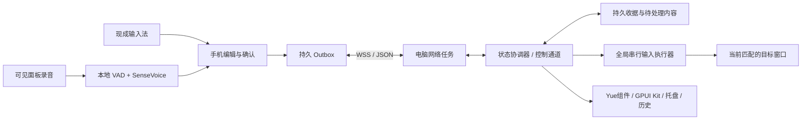
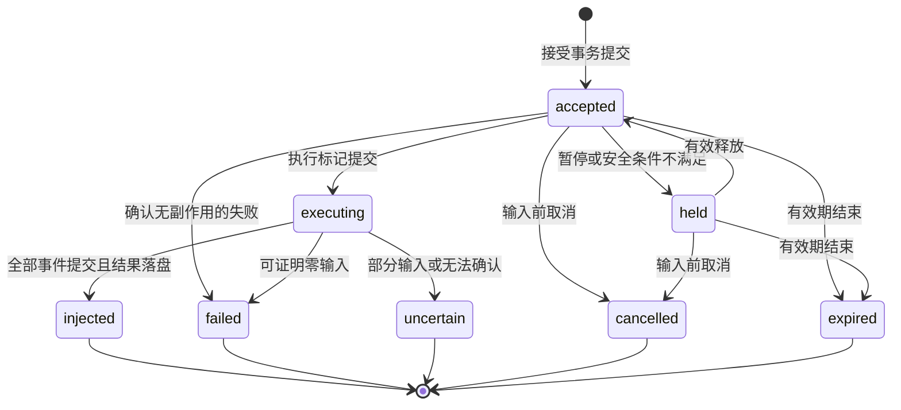

# SayIn：通信协议与低延迟技术方案 v2

更新：2026-11-15（初稿 2026-11-12）。  
状态：文字、Enter 与双 WSS 单张图片链路已实现；隔离真机 LAN 传输及生产 NativeInput 临时 EDIT/RichEdit 已验证。核心大图、受控慢网/暂停及有限时长完整历史 GUI 内存已实测，首版图片阶段验收完成；用户应用反馈与 API 29/33/37 平台结果见 46、49。软件精确版本、真实差 Wi-Fi/长期负载、VRAM 和续航仍以逐项记录为准，不将 fake 输入当作实际上屏。  
适用范围：Android 10+（API 29）原生 App ↔ Windows 原生常驻程序，同一可信局域网 IPv4 内传送最终文字、Enter 和单张静态图片。最低系统与平台 TLS 1.3 要求一致，详见 [49](49-android-platform-support-and-validation.md)。
命名：产品名 SayIn，协议名 `voicelink.v2`。

## 1. 结论与设计依据

**继续采用持久 WSS 连接、TLS 1.3、UTF-8 JSON。** 对几百字节到几 KB 的最终文字，没有证据表明换成 QUIC、自定义 UDP、二进制编码或音频传输就能改善主要体验。先解决连接唤醒、确认语义、磁盘提交、输入注入、焦点保护和有界排队，再依据剖析结果优化。

2026-11-15 图片扩展决定：用户选定**双 WSS**。现有 `/v2` 继续承载文字、身份认证、状态与回执；按需 `/v2/images` 承载单张图片的有界二进制顺序块，同一 TLS 1.3 固定证书、同一精确网卡/IPv4/端口监听。图片连接必须绑定当前已认证控制会话；仅持有发现地址或上传 ID 不构成授权。控制断开、代次/范围变化、撤销、暂停或取消不得留下未来自动粘贴授权。不得在验证证书前发送凭据，不新增配对或接纳新证书。资源准备与 submit 分开；重连先查旧收据，不自动上传、submit、release 或重贴。选择依据、资源限额和实施状态见 [38 图片设计](38-image-input-design.md)、[44 Kotlin 同期实测](44-kotlin-all-transports-wifi5-benchmark.md)和 [45 实施记录](45-image-input-implementation.md)。双端生产传输、持久化和图片界面已实现并通过阶段 3–5 验证；生产核心 15 次真机 LAN 原生粘贴与大图测量见 [46](46-image-input-production-validation.md)。浏览器/Word、聊天草稿、透明 PNG 与历史操作已有用户通过反馈，平台补验见 [49](49-android-platform-support-and-validation.md)。首版有限验收不代表所有应用兼容或任意网络下的性能保证，具体证据边界见 46。

### 图片扩展基础类型（阶段 2）

双端共享以下严格基础格式；电脑配置受保护图片目录后才开放图片 capability：

- `ImageMetadata` 为精确字段 `{bytes,mime,width,height,sha256}`。`bytes` 为 1..10485760，MIME 仅 `image/png` / `image/jpeg`；方向处理后的宽高均 1..8192、乘积不超过 16000000。`sha256` 为最终冻结编码字节的 SHA-256 小写 64 位十六进制。整数不接受字符串/浮点替代；未知字段拒绝。
- `ImageReference` 为 `{resource_id,metadata}`，resource_id 是电脑分配的 canonical UUID v4，区别于上传 ID 和 submit 请求 UUID。引用中的全部元数据必须参与原请求指纹，不能只对 ID 去重。
- 图片块为一条完整二进制 WS 消息：字节 0..3 是 ASCII `SIMG`；4..19 为上传 UUID 的 16 个 RFC4122 网络序字节；20..27 为大端 u64 起始偏移；28..31 为大端 u32 正文长度；32.. 为 1..49152 字节正文。消息长度须等于 32＋声明长度，偏移必须等于已接收字节数，结尾不得超过声明总长。没有单图多流或乱序重组。
- 错误、重复块、乱序、会话/设备/接收范围/版本变化或期限超出会使整次上传失效，不能忽略坏块后继续 finish。空闲期限 60 秒、绝对期限 300 秒；finish 同时校验完整长度与摘要，解码及实际 MIME/尺寸验证仍是成为资源的必要条件。

跨语言黄金向量：上传 ID `12345678-1234-4234-8234-123456789abc`，offset=0，正文 `01 02 03`，完整帧 hex 为 `53494d4712345678123442348234123456789abc000000000000000000000003010203`。该三字节正文只验证二进制格式，不是可接受的图片。

### 图片双 WSS 消息（阶段 3）

电脑在当前已认证 `/v2` 的 `welcome` 中增加 `image` capability 和 `image_channel`：`{path:"/v2/images",binding:"<32 字节随机值的 base64url>",max_image_bytes:10485760,max_pixels:16000000,max_side:8192,chunk_bytes:49152}`。未配置资源存储时 channel 为 null、不广告 image。binding 只属于这一条控制连接，不能用于创建或替换控制会话，不进入发现广播或日志。

图片连接沿用保存的精确端点、完整固定证书与 tls_name；TLS 验证完成后首条发送 `{v:2,t:"image_hello",session_id,device_id,binding}`。服务端核对当前控制会话与常量时间 token 比较，回复 `{v:2,t:"image_welcome",session_id,host_id,device_id}`。首版一条图片连接处理一张图，每控制连接最多一条，主机最多两条，后台完整解码/保护一次一个；不新增监听端口，不更改网卡/Windows 范围约束。

| 通道 | 消息 | 结果与边界 |
| --- | --- | --- |
| 图片 | `{v:2,t:"image_begin",session_id,id,target,state_rev,metadata}` | id 是新上传 UUID；精确匹配当前接收范围，回复 `image_begun{id}` |
| 图片 | SIMG 二进制块 | 顺序追加，回复 `image_progress{id,received}`；received 是累计字节，不代表持久接受 |
| 图片 | `{v:2,t:"image_finish",session_id,id}` | 完整性、实际图片校验、DPAPI 同步落盘与范围复核后回复 `image_ready{id,image:ImageReference}` |
| 图片 | `{v:2,t:"image_cancel",session_id,id}` | 回复 `image_canceled{id}` 并结束本次连接，回收未接受资源；不能代替已接受输入的 cancel |
| 控制 | 原 submit，op 为 `{kind:"image",image:ImageReference}` | 独立请求 UUID；资源必须来自相同 device/session/target/revision，且未过期、未消费；WAL/FULL 接受事务完成后才返回 accepted |

图片回复同样带 `v:2,t`，上传回复带原上传 id。未知操作、格式/顺序/范围错误结束整次图片连接，不继续使用部分资源。上传中空闲 60 秒、总计 300 秒，准备资源最多保留 60 秒；图片 JSON 沿用 10 条/秒限制，二进制块独立限制 4096 条/秒、突发 256 条，避免微小块耗尽调度；这不是固定的图片字节限速。按块及每秒检查授权和范围，后台解码结束后及资源注册时再次核对。控制断开、会话替换、设备撤销及网络监听停止都会阻断旧任务；本地暂停/换范围使单次图片意图失效，恢复不会复活它，新图片可以在恢复后重新明确发送。

账本 schema 6 用 `image_resources` 将 device、规范元数据、资源 ID 与 receipt accept_order 绑定；不把大图放入 SQLite/文字字节配额。接受事务用图片 pending 部分索引限主机 2 / 每设备 1，并保留原有操作数、去重与接受期限。完整 op/目标参与 HMAC 指纹；同请求同图直接返回旧回执，同 ID 换资源或元数据拒绝。资源先落盘，接受后转为持久资源；未接受资源由有限所有权及独立清理线程回收，后台任务取消仍会释放，清理失败阻断新资源而不静默突破预算。启动检查已引用文件缺失后拒绝继续，孤儿只在启动维护中扫描。

图片执行沿用串行输入、前台身份、会话授权、暂停代次和持久 `executing` 边界。上传持久化前完整解码校验，执行前再次校验受保护资源的长度和摘要。执行时先把收到的 PNG 或 JPEG 字节保存到电脑端配置的接收文件夹，默认位置为系统下载目录下的 `SayIn`。桌面端按前台进程的可执行文件完整路径匹配用户设置，路径比较遵循 Windows 不区分大小写的序数规则。没有覆盖规则时，`WindowsTerminal.exe` 使用复制路径，其他应用使用粘贴图片。复制路径方式发布 Unicode 文件路径并返回 `method=clipboard_image_path`，由用户在目标应用中粘贴。粘贴图片方式发布 PNG/DIBV5 并提交一次 Ctrl+V，返回 `method=clipboard_image`。两种方式都设置剪贴板隐私标记，实际文件路径留在电脑端。文件保存或剪贴板操作失败时返回相应原因，已经写入的文件留在接收文件夹。

可能已输入或执行中崩溃仍为 `uncertain`，待执行重启为 `held`。旧图片 `held` 需先核对旧请求，再明确发起新图片操作。重连只查询收据。

### Android 图片提交与恢复（阶段 4）

手机从系统授权 URI 有界读取、归一化方向和颜色、移除 GPS 后冻结 PNG/JPEG 字节，计算摘要并以独立图片 AAD 在 noBackupFilesDir 加密保存；预览和传输使用这一份载荷。Room schema 3 以同一 host/device 范围维护图片草稿与 Outbox 引用。先持久保存 uploading 请求，再上传；image_ready 后持久保存引用操作，最后由原控制连接 submit。上传 ID、资源 ID 与外部输入请求 UUID 分开。

传输窗口最多四个未 ACK 的 48KiB 块；ACK 必须匹配最早在途块的精确累计末端，不接受跳跃/倒退。取消、退出需求、暂停、范围/连接代次变化关闭图片连接并撤销本次提交意图；已 submit 的请求不能当作未发送删除。恢复先查询旧 UUID，unknown 进入人工核对，不自动上传/submit/release；旧图片引用不允许 retry/release。草稿、加密历史和原配对身份保留。

v1 具备合理的传输基础，但不能据此认定已满足「低延迟、速度快、高性能」。其主要问题是：把接收与上屏混为一谈；承诺崩溃后恰好上屏一次；暂停文字可能阻塞恢复指令；去重窗口和补发机制不完整；没有计算持久化和粘贴等待；高估 Android 后台保活能力。

v2 的核心约定：

1. 区分「手机已入发送队列」「电脑已持久接受」「输入事件已提交」「目标应用已显示」。通用系统接口只能可靠报告其中一部分。
2. 使用请求 UUID 去重，由电脑分配接受顺序；不沿用 v1 的客户端连续 `seq`，避免丢弃草稿或过期消息造成序号缺口。
3. 控制指令独立调度，暂停队列不会阻塞 `resume`、`cancel`、状态查询或心跳。
4. 同一请求最多自动尝试一次外部输入；崩溃窗口标记 `uncertain`，用户核对后决定是否重新发送。
5. 接受确认以持久化为边界，必要磁盘同步进入延迟预算；历史列表、GUI 刷新和可选 LLM 不阻塞基础输入链路。
6. 初期允许配对多部手机，但同一时刻只有一个活动发送设备；所有系统输入共用一个串行执行器。
7. 所有性能数值均为**待验证目标或初始配置**，不是本项目已达到的成绩。

### 1.1 输入资料与优先级

| 资料 | 用途 |
| --- | --- |
| [原始对话](../refer/log1/Claude-台式电脑语音输入方案-20261112-1526.md) | 用户场景、平台、交互与功能要求；其中模型速度估计不作为实测证据 |
| [v1 草案](../refer/log1/语音直达%20通信协议%20v1（草案）.md) | 现有协议基线与问题对照 |
| [交互 Demo](../refer/log1/语音直达%20·%20手机说话，电脑光标落字.html) | 手机 App、娱乐中唤出、桌面控制台的视觉参考；功能均为模拟 |
| 官方规范、官方 API 文档 | 决定能力边界与平台约束，优先于论坛与项目 README |
| 同类项目的固定提交源码 | 观察具体实现与取舍，不直接推导本项目延迟或安全保证 |

项目处于开发阶段。v2 直接修正协议结构，不增加 v1 兼容适配、迁移层或双协议维护。

## 2. 产品要求与范围

### 2.1 必须保留的体验

| 要求 | v2 约定 |
| --- | --- |
| 电脑工作、手机娱乐，随时说一句 | 悬浮球、常驻通知、快捷设置磁贴作为入口；在可见输入面板内录音 |
| 现成输入法语音 | 手机 App 普通编辑框接收输入法输出，发送最终文字；不承诺获取输入法内部音频或流式识别状态 |
| App 内离线识别 | Kotlin App 集成 sherpa-onnx，优先验证 SenseVoice int8 + VAD；不开发自定义 IME |
| 短句省操作、复杂内容可确认 | 简短内容允许自动发送；长句、长时录音、技术英文等转确认；编辑立即取消倒计时 |
| 防错发 | 目标窗口绑定、焦点检查、全局暂停；错误目标时保持待确认，禁止强行切焦点输入 |
| 随时检查和重用内容 | 手机和电脑历史、常用语、文本修正规则；重发是明确的新操作 |
| 可选润色与语音命令 | LLM 默认关闭；命令须进入明确的命令模式并确认，普通文本不解释成快捷键 |
| 原生软件 | Windows Rust 核心 + GPUI Kit GUI；Android Kotlin 原生 App；核心服务不依赖主窗口存活 |
| 统一视觉 | 主题色 `#1f75db`；非主题色使用 `D:/100_Projects/110_Daily/Yue-Design-System/packages/tokens` 的 neutral 系列，状态依靠图标与文字表达 |

初始智能发送参数沿用交互参考：不超过 18 个用户可见字符、录音不超过 6 秒、无规则命中的复杂内容，才进入 1.6 秒可取消倒计时。阈值可配置；它们是交互启发式，**不是识别准确率或置信度保证**。不同输入法未必提供可靠的录音时长，缺失数据时使用保守确认策略。

### 2.2 首期不做

- 音频跨设备传输、真正连续替换电脑输入框、云端中继、公网穿透。
- 自定义输入法、在所有 App 后台持续录音、保证所有 Android 厂商永不杀进程。
- 通用终端标签页/编辑器光标位置锁定、通用可靠撤销、跨应用事务式输入。
- 不加密的浏览器备用页。浏览器可以使用 HTTPS/WSS，但原生证书固定与配对方案不能直接照搬到普通网页。

后续若实现流式预览，仅更新本产品预览区；不把修订中的识别文字写入任意第三方应用。

## 3. 官方资料调研：结论及影响

调研与查阅日期为 2026-11-12。在线文档可能更新；平台行为必须结合实际系统版本、target SDK 和所选依赖版本复核。

检索时发现 OkHttp 的旧 Square 文档地址已有失效情况。Commonhaus 的官方公告确认其于 2026-06-17 加入基金会并迁到 `lysine.dev`；本次据此核对 `lysine-dev/okhttp`，不是把陌生镜像当成官方来源。[S14] 下方源码引用固定到查阅时的提交，避免滚动分支变化。

| 官方资料事实 | 对本项目的影响 |
| --- | --- |
| WebSocket 基于 TCP；Ping/Pong/Close 是协议控制帧，应用 JSON 消息不是协议控制帧。[S1] | 可复用成熟实现；同一 TCP 流仍有队头阻塞，应用优先级不能越过已进入 socket 的字节 |
| OkHttp `WebSocket.send()` 成功表示消息进入本地发送队列；`queueSize()` 不是所有在途字节。[S2] | 不能显示为「已送达」；必须检查返回值，设置自己的小队列，并等待业务状态 |
| OkHttp `CertificatePinner` 本身不能让原本不被 TrustManager 信任的自签证书变可信。[S3] | 要配置限定到已配对主机的信任材料，并保留主机名验证，禁止 trust-all |
| `SendInput` 返回插入系统输入流的事件数；受 UIPI 影响，只能向相同或更低完整性级别应用注入。[S4] | 只能称「输入已提交」；不能宣称目标应用已经显示或执行，管理员窗口可能失败 |
| 剪贴板序列号随内容变化而改变，但不是目标程序已经读取粘贴内容的回执。[S5] | 恢复剪贴板只能尽力而为，不能用固定 sleep 证明粘贴完成 |
| Wi-Fi `LOW_LATENCY` 锁要求已连接 AP、屏幕开启、申请 App 位于前台，并有功耗等代价；`HIGH_PERF` 从 API 34 废弃并转向低延迟锁限制。[S6] | 前台服务不等于满足所有条件；不能保证手机娱乐或熄屏时同样生效 |
| Android 12+ 限制后台启动前台服务；Android 14+ 对服务类型和 while-in-use 权限有进一步检查。[S7][S8] | 从用户点击入口进入可见 Activity 再录音；前台服务不能作为绕过后台麦克风限制的方法 |
| 当前官方文档规定 Android 17/API 37 且 target SDK ≥37 的 App 需处理 `ACCESS_LOCAL_NETWORK`；限制覆盖原始 socket、OkHttp、mDNS 等。[S9] | 局域网失败需区分权限与网络故障；不能只申请 `INTERNET` 就假设所有版本可用 |
| SQLite WAL + `synchronous=FULL` 每次提交同步 WAL；`NORMAL` 在系统崩溃/断电后可能回滚已经提交的事务。[S10] | 若承诺持久接受，不能先发 ACK 后异步落盘，也不能偷偷改 NORMAL 来达到延迟指标 |
| sherpa-onnx 提供 SenseVoice 的 ONNX、Kotlin 和 Android 支持；SenseVoiceSmall 采用非自回归架构。[S11][S12] | 可作为本地最终识别候选；官方其他硬件测试不能证明用户手机的耗时、温升或中英技术词准确率 |

## 4. 同类项目调研

以下是方案对照，不是速度排行榜。没有对这些项目执行统一环境性能测试，也未做完整安全审计。固定提交用于让结论可追溯。

| 项目与源码快照 | 已核实实现 | 可借鉴内容 | 不直接采用的部分 |
| --- | --- | --- | --- |
| [mofanx/voice-input](https://github.com/mofanx/voice-input)，`7bdae00267f212aec4f4feca55e4644e179989d0` | 本地 HTTP POST 接收文字，剪贴板/可选粘贴；另有 WebSocket 中继。源码有粘贴前 80 ms、恢复前 150 ms 的固定等待，恢复默认关闭。[P1] | 输入法编辑框、停顿发送、历史、终端场景；可选恢复剪贴板的产品取舍 | 不把本地 HTTP 描述成 WebSocket，不照搬固定等待与命令执行范围；调研时未确认完整复用许可 |
| [cold-land/airinputlan](https://github.com/cold-land/airinputlan)，`6a28e7c7c8b3931f19252c0f2eca3a4085091573` | Go 版本有 SSE 分发、客户端集合与心跳；README 描述后续重写和架构调整。[P2] | 转换结果应有明确归属；输入结果、确认、控制需要完整反向通路 | SSE 单向推送不意味着不能用反向 HTTP；这里选择一个双向连接以简化应用状态机，不声称 SSE 天生慢 |
| [ciddwd/VoiceInput](https://github.com/ciddwd/VoiceInput)，`f9945a24f5bd3ad0fa17fb628ef4527dce692d2a` | Wails/Go 桌面、Flutter 手机；JSON 带消息 ID、ACK；WebSocket 服务及 Windows 输入模块。粘贴路径有 200 ms 等待后恢复剪贴板；服务源码说明 Ping 处理应更新读期限。[P3][P4][P5] | 这是较接近的手机到电脑方案；可对照配对、发现、Unicode/粘贴分路与生命周期处理 | ACK 字段不等于完整崩溃恢复协议；不照搬其安全配置或粘贴延迟，不能由 README 推定满足本项目 TLS/性能要求 |
| [KDE Connect](https://kdeconnect.kde.org/) | 官方项目支持设备配对、加密通信和远程输入；有协议身份保护的官方设计讨论。[P6][P7] | 设备身份、用户确认、撤销和可见连接状态是基本能力 | 不为单一输入场景引入整个插件体系；引用的 MR 是设计讨论，不据此认定某项协议已在所有版本发布 |

这些样本说明：**传输协议只是链路的一部分，粘贴策略、ACK 语义与连接生命周期足以主导结果。** 项目热度、语言、README 的「低延迟」表述均不等于可复现性能证据。

此前讨论提及的 `chxcodepro/VoiceSync` 在本次调研中无法访问，GitHub API 返回 404；因此不把其功能、归档状态或性能作为结论依据。

## 5. 架构与职责



### 5.1 选型

| 层 | 初始选择 | 理由与边界 |
| --- | --- | --- |
| 手机 UI/生命周期 | Kotlin 原生 Activity、系统通知、磁贴、可选悬浮入口 | 符合用户场景；不依赖网页后台存活 |
| 手机网络 | OkHttp WebSocket + Kotlin 序列化 | 复用成熟 TLS/连接实现，业务可靠性由本协议定义 |
| 离线识别 | sherpa-onnx + SenseVoice int8 + VAD | 官方 Android 路径明确；模型与运行库锁定版本、校验下载哈希，线程数通过实测决定 |
| 电脑运行时 | Rust + Tokio | 网络和任务调度；不在异步工作线程阻塞执行磁盘或 Win32 输入 |
| 电脑 WSS | tokio-tungstenite + rustls | 直接服务持久连接；不为首期额外运行 Web 控制台。接受的 TCP socket 在 TLS/WS 握手前设置 NODELAY |
| 电脑 GUI | 本地Yue-GPUI-Component，基于GPUI Kit/Base | 用户指定组件库；GUI订阅核心状态，窗口关闭不停止核心；接入补丁见07文档，无需嵌入Web前端 |
| 持久化 | SQLite WAL + FULL；专用数据库工作线程 | 保留可靠性证据；读历史、维护、检查点需避免抢占关键写入 |
| 系统输入 | 独立串行工作线程，Win32 `SendInput` / Clipboard | 一次只操作一个目标；不在网络回调内 sleep、取剪贴板锁或逐字注入 |

依赖精确版本在实现时锁定并记录。tokio-tungstenite 的客户端连接函数提供 Nagle 配置，不代表服务端接受连接已经自动正确配置；两端均需核对实际 socket 行为。[S13] OkHttp 的具体 NODELAY 行为以锁定版本源码及抓包为准，不为设置选项绕过其 TLS 实现。

### 5.2 调度约束

- 网络 reader 始终可处理心跳、控制和状态查询，不等待某条文字最终输入。
- writer 有独立且有界的高优先级控制/状态队列、普通操作队列；不把大量历史或草稿先塞进底层 WebSocket 队列。
- 协调器只做短时校验与状态推进，等待数据库通过异步返回；不能持有全局锁等待磁盘或 GUI。
- 必须持久化的步骤确实在关键路径上；「放到数据库线程」只是隔离阻塞，不会消除 fsync 时间。
- GUI 推送可合并，预览可覆盖旧版本；最终操作及收据不可静默丢弃。
- LLM、联网词典、模型下载和复杂插件均不进入基线提交路径。

## 6. 传输、发现与安全配对

### 6.1 传输约定

| 项目 | v2 约定 |
| --- | --- |
| 端点 | `wss://<tls_name>:<port>/v2`，WebSocket 子协议协商不作为身份验证 |
| 端口 | 默认 7788；占用时选择可用端口，并更新二维码和发现信息 |
| TLS | TLS 1.3；主机身份持久保存；禁用 TLS 0-RTT 输入请求，避免早期数据重放问题 |
| 消息 | 每个应用消息是一个 JSON 对象；不得在一个消息里拼接多个 JSON 文档 |
| 大小 | 单帧及重组后的单消息均最多 64 KiB（65,536 字节）；防止分片绕过限制 |
| 提交大小 | submit 编码后的 JSON 最多 32 KiB（32,768 字节），确保给控制消息留出发送预算；未知可选字段同样计入 |
| 文字 | 最多 4,000 个 Unicode scalar，且 UTF-8 原文最多 16 KiB；JSON 转义后仍须满足消息总上限 |
| 控制 | 单个控制/查询消息最多 8 KiB；禁止二进制数据和音频帧 |
| 压缩 | 不协商 `permessage-deflate`；初期不压缩小文字消息，不声称压缩在所有场景都更慢 |
| 发送 | 不设人为批量等待，及时 flush；检查库返回值与缓冲字节；正常网络流量不逐条重建连接 |
| 握手期限 | TLS/WS 及应用认证各自设置超时；WS 建立后 5 秒内必须完成 hello 或进入有效配对请求 |

UTF-8 必须合法，拒绝不成对的 surrogate、重复 JSON key、错误类型和超深嵌套（初始最大深度 8）。未知可选字段忽略；未知必需能力或未知操作拒绝，不能猜测执行。字段名、状态值和错误码区分大小写。

### 6.2 发现不是信任

当前实现由 Windows 在已选定且仍有效的监听网卡发布 `_voicelink._tcp.local`。使用 Windows `DnsServiceRegister`，请求与实例均指定非零接口索引，IPv4 和端口取实际已绑定的监听端点；loopback fixture 不发布。实例为 `SayIn-<host_id>`，TXT 为 `v=2`、`host_id=<UUID>`、`ipv4=<当前绑定地址>`，SRV 端口取实际监听端口。没有 token、证书、配对码或邀请秘密。

Windows 原生接口在本机实验中不会为自定义 `vl-<host_id>.local` 提供可解析的 A 记录，因此 SRV 指向系统实际的 `<computer DNS hostname>.local`。这是发现用 DNS 名，不是 TLS 身份。Android 只使用解析地址中与 TXT `ipv4` 一致且位于当前 LAN IPv4 前缀的地址；不采用其他网卡地址。系统已有的主机 DNS 记录不建立 SayIn 信任。服务发布随原监听生命周期撤销，网络 GUID/类别、接口或 IPv4 范围失效后不保留旧发布；约 2 秒轮询及最长 3 秒系统查询仍有既有检测窗口，DNS 缓存也可能短暂保留旧候选。

Android 前台或用户已开始录音时先连保存端点，失败后执行一个有界系统 NSD 回合；切网先废弃旧 socket/session/自动发送票据，再按同一路径恢复。同一回合浏览 2 秒，最多观察 8 个名称匹配的服务，单次解析最多 2 秒，总发现预算 12 秒，最多 4 个去重候选，串行候选认证每个最多 6 秒。一个回合结束后进入同一条 1/2/5/10 秒重连退避，不叠加发现重试循环。无可见入口且未录音时停止；不扫描网段、不引入多电脑选择、公网中转或空闲常驻发现。

**所有发现字段都不可信。** 实例名称/host ID/版本/IP/端口只参与有界过滤。候选只替换临时路由，仍使用原保存的 `tls_name` 构建 WSS URL、原完整 DER 固定证书与 SAN 验证；仅 TLS 验证完成并触发 WebSocket Open 后发送原 device UUID/token。收到并完整验证原 host/device 的 `welcome` 后，才加密持久更新同一主机的 IPv4/端口。拒绝新证书、不自动配对、不用发现数据重建凭据。多候选不并发发送凭据；迟到回调按连接 generation 丢弃。

认证恢复后先查询旧 Outbox，不自动 submit/release，不清草稿、历史或身份，不解除主动暂停、存储阻断及 `uncertain`；恢复新输入范围也不释放旧 held。广播同名/伪造 host ID、错误证书和已撤销设备均不能恢复授权。

API 37+/target 37 检查并按用户操作申请 `ACCESS_LOCAL_NETWORK`，拒绝时不尝试局域网连接或发现；应用有连接需求时监测授权撤销并关闭任务。无需系统设备选择器重复确认已配对电脑。API 34+ 解析使用可注销 `ServiceInfoCallback`，API 29–33 使用系统旧解析 API；不支持 `stopServiceResolution` 的系统只能等待单个在途 OS 解析返回，应用立即取消浏览/候选/多播锁，以单在途占位禁止叠加，迟到结果不能使用。多播受阻、访客隔离、跨 VLAN 或发现/认证失败保留“更新电脑地址”入口，不要求删除配对，不降级明文或任意证书。实现与实测边界见 [40 自动发现与重连](40-paired-host-discovery-and-reconnect.md)。

### 6.3 配对信任材料

首期支持两种等价入口，用户择一：手机扫描电脑展示的二维码，或在手机输入电脑显示的 IPv4 地址、端口和 8 位数字配对码。两条路径最终都进入同一台电脑的本地批准步骤。首次使用自动启动监听并展示邀请，已有设备启动只恢复监听，不要求重新扫码。自动优先物理接口、同类中优先上次成功路径；故障排查可在连接帮助里临时选择其他路径。Private/Domain/Public 使用相同流程，不再要求应用内公用网络会话授权；网络分类不决定手机身份信任。监听精确绑定网卡 GUID、IPv4、Windows 网络 GUID/类别集合，不监听 `0.0.0.0`，不修改 Windows 分类或防火墙。同一端口同时接收 `VLCP2\n` 代码握手与 TLS，优先 7788，端口占用时使用系统分配端口。启动前和监听期间约每 2 秒通过 Windows Network List Manager 核对绑定范围；接口、地址、网络标识/类别变化，查询失败或 3 秒查询超时则暂停输入、关闭旧服务及连接。桌面端约每 2 秒自动尝试恢复可用监听，不重置设备信任；仅对网络中断造成的暂停恢复新输入范围，主动暂停和待核对仍保留，旧文字不自动补输。周期检测存在检测窗口，不提供网络切换原子保证。当前已接入 IPv4 mDNS/系统 NSD 恢复；IPv6 尚未实现。Android 优先保存端点，失败后按 6.2 有界发现，完整认证后才持久更新路由。详见 [29 接收页重构](29-desktop-receive-ui-refactor.md)。

1. 电脑生成并持久保存主机 ID、私钥与自签叶证书。证书 SAN 含稳定的 `vl-<host_id>.local` 名称；证书有效期受检查。
2. 首次使用自动展示配对窗口；后续由电脑用户明确添加手机或刷新过期邀请，有效期 120 秒。二维码带 `host_id`、`window_id`、`tls_name`、IPv4、端口、完整证书 DER、证书 SHA-256 和 128 位随机一次性秘密。手工配对先在同一端口通过 `VLCP2\n` 帧执行 1Password CPace；使用 Git 仓库 `1Password/cpace` 锁定提交 `7e2e42c7d359969f4356292c2bd2cf3ff6eeeecc`，不是 crates.io 上同名的其他实现。CPace 认证并确认代码之后，通过 HKDF-SHA256 与 ChaCha20-Poly1305 加密传递邀请信息。
3. 两种入口都使用**仅此主机专用**的信任配置，固定完整 DER 叶证书，保持 `tls_name` URL、限制 DNS 映射到邀请 IPv4，并继续做 SAN/hostname 验证。仅启用 TLS 1.3、关闭 0-RTT；禁止全局宽松 HostnameVerifier 或信任所有证书。
4. WSS `/v2` 建立后提交包含 `window_id` 的配对请求；电脑显示设备名并由用户批准。批准后立即消费短期配对窗口，再通过 receiver 账本持久签发授权；崩溃或持久失败要求重新开启配对，不声称窗口消费与 SQLite 提交为一个原子事务。
5. 电脑签发 256 位随机 bearer token，仅在 TLS 内发送；电脑保存其 HMAC，手机使用 Android Keystore AES-256-GCM 加密保存 token 与配对配置。Windows 私密材料由 DPAPI 保护，受保护目录设当前用户/SYSTEM ACL。
6. 手机将凭据成功写入加密存储后才进入已配对状态。断线后先以相同授权查询所有本机待处理 ID；`unknown` 标记需用户核对，`uncertain` 永不自动重试。手机只在终态回执成功写入 Room 后清除文字载荷。应用在后台断开 WSS，不承诺系统后台持续保活。

二维码本身是敏感授权材料，不写日志、不上传、不长期开着。配对码不是自签证书的密码；TLS 证书邀请信息必须经 CPace 派生密钥认证并 AEAD 加密。CPace 上游审计不覆盖本项目的新协议封装、JNI、邀请字段或电脑批准界面；本项目实现仍需独立安全审查。

证书变更、到期或私钥丢失时停止连接并要求明确重新配对，不能自动接受新指纹。桌面按授权 UUID 显示已授权设备，逐设备撤销需明确确认；手机自报昵称仅显示在当次批准流程，未保存为权限依据。撤销操作立即关闭输入闸门、持久撤销授权并取消尚未开始的操作，活动连接通过接收操作与 2 秒 watchdog 进行 fencing；已经开始的系统输入只能报告实际结果，无法撤回。恢复旧数据库或丢失去重账本时，必须使旧授权整体失效后重新配对。

## 7. 会话、心跳与首次发送

### 7.1 会话规则

- 一套设备授权只有一个当前会话。新 hello 认证成功时生成 `session_id`，旧会话被 fencing：旧 reader、writer、排队调度不得继续接受新操作。
- 已持久接受的操作属于设备授权，不属于 socket；旧连接断开不能抹掉结果，也不能令已经进入输入步骤的操作重复执行。
- `host_id` 标识主机；`device_id` 是电脑签发的授权 ID；重配生成新授权 ID。认证前手机自报的名字不作为权限依据。
- 多部手机可在线查看状态，但仅 `active_device_id` 能提交文字/按键。切换由电脑用户确认，旧设备未完成操作先取消或处理完，不自动混入新设备队列。
- 未知主版本拒绝；v2 不与 v1 自动降级。可选能力在 welcome 中列出，未协商能力不能发送。

### 7.2 心跳与重连初始参数

| 场景 | 当前实现（性能目标不等于实测结果） |
| --- | --- |
| 输入面板或用户录音活跃 | 手机每 8 秒发送应用 ping；Tick 中检查 25 秒无有效入站阈值，存在 Tick 检测窗口 |
| 无可见入口且未录音 | 断开 WSS、取消发现与重试，不保持空闲后台连接 |
| 用户打开面板/准备发送 | 复用有效连接；新连接先认证与查询旧请求，发送校验完整 ReceptionScope；没有独立 300ms 唤出探测 |
| 网络切换/地址失效 | 网络回调使旧 socket/session/generation 作废；优先保存端点，失败后有界发现 |
| 重连退避 | 同一调度器按 1/2/5/10 秒退避；10 秒为回合间等待上限，不含连接/发现耗时；显式重连可立即尝试 |
| 接受结果未知 | 保留同 ID/payload；重连先查询，可显式查询/核对，不换新 ID 自动再发；没有独立 1 秒 ACK 计时器 |
| 执行耗时异常 | 保留回执身份并查询；held 30 秒期限由电脑推进，等待/暂停不等于网络失败，不自动补输 |

应用 ping/pong 携带 nonce，pong 另带仅用于前台应用展示新鲜度的 `foreground_seq`，不携带业务操作。WebSocket 协议层 Ping/Pong 由库正确处理；不要同时启用两套互不协调的超时判断。应用 JSON 控制与文字共用一个 TCP 流，优先级只能作用于尚未写出的消息，不能宣称有独立物理通道。[S1]

## 8. 消息格式

### 8.1 通用约定

所有会话内应用消息包含 `v:2`、`t`、`session_id`。`hello`、`pair`、`paired` 不带尚未建立的会话 ID。服务端 `welcome` 给出会话 ID。认证后不再反复发送 token；设备身份从会话获得。

- `id`：操作或控制请求的 UUID v4，小写标准字符串；用途不可混用。
- `order`：电脑持久分配的全局递增接受顺序，十进制字符串，避免不同语言的整数精度差异。
- `state_rev`：电脑持久递增的全局控制状态版本，十进制字符串；暂停、活动设备、目标绑定及人工释放发生变化时推进。
- `target`：电脑本地开启接收时签发的不透明输入激活范围 token；本地重新开启时轮换，客户端不得自行生成或解析。当前光标模式不把它解释为固定窗口句柄。
- 时间间隔使用非负毫秒整数。手机墙钟仅用于历史展示，**不作为排序、超时或安全授权依据**。

### 8.2 消息清单

| 方向 / t | 必需内容 | 语义 |
| --- | --- | --- |
| 手机 → `pair` | v, name, window_id, secret | TLS 已基于扫码信任材料完成；请求人工批准 |
| 电脑 → `paired` | v, device_id, token, host_id | 配对结果，含敏感 token，不记录日志 |
| 手机 → `hello` | v, device_id, token, name | 创建认证会话，并在令牌认证成功后刷新设备显示名称 |
| 电脑 → `welcome` | v, session_id, host_id, device_id, active_device_id, state_rev, paused, target, capabilities, limits | 认证、状态和资源限制；target 无可用目标时为 null |
| 手机 → `submit` | id, op, target | 提交一个最终操作；op 为 text 或 key，见下文 |
| 电脑 → `status` | id, st；已接受时有 order | 返回当前/最终状态；可带 reason、method、server_ms、application |
| 手机 → `query` | id, refs | 查询最多 32 个本设备操作 ID；服务端逐个返回 status，完成后返回 queried |
| 电脑 → `queried` | ref | 对应 query.id，表示本次状态快照已发完 |
| 手机 → `control` | id, name；按操作带 refs、expected_rev、target | 独立控制队列，不能作为系统按键执行 |
| 电脑 → `controlled` | ref, ok, state_rev, paused；可带 reason、in_flight | 控制结果；ref 对应 control.id |
| 电脑 → `state` | state_rev, paused, active_device_id, target | 状态变化；可带最小化的 focus_label 与 pause_reason |
| 双向 `ping` / `pong` | nonce；pong 的 foreground_seq | 应用活性探测；pong 回显 nonce，仅确认展示序号 |
| 电脑 → 手机 `foreground` | session_id、seq、name、icon_png | 已认证连接内的前台应用名称及可选实际图标；仅供展示 |
| 电脑 → `err` | code, ref?, retry_after_ms? | 未接受的格式/权限/流控等错误；ref 指向相关请求 |

`pair.name` 与 `hello.name` 是显示元数据，必须为非空、无控制字符、最多 64 个 Unicode 码点的名称。手机优先读取只读商品名称属性，回退到 `Build.MODEL`，再回退 `Android`；不使用设备代号，不因界面语言翻译名称。详见 [24 设备名称方案](24-android-device-display-name-plan.md)。

`hello.name` 仅在设备 UUID/令牌认证成功且授权未撤销后由账本协调线程保存；无效名称或认证失败不得更新元数据。更新不改变 device/host 身份、令牌、接收闸门、暂停状态、激活范围、状态修订号、Outbox 或去重身份，不触发发送/重试。既有配对通过普通重连刷新名称，无需重新配对。每条历史保存接收时的来源名称快照，不因后续改名批量重写。开发阶段双端统一使用这一字段，不设置旧握手兼容分支。

`submit.op` 只允许：

- `{"kind":"text","text":"…","src":"ime"}`：`src` 取 `ime`、`asr`、`manual`、`favorite`。文本为用户最终确认的不可变结果。
- `{"kind":"auto_text","text":"…","application":"Editor"}`：自动倒计时结束后的不可变文本，含当时目标应用的显示名称。Windows 输入线程要求预检目标的名称匹配，随后继续原生前台特征校验；不匹配以 `automatic_target_changed` 终结。应用名纳入去重指纹，需双端同时升级。
- `{"kind":"key","name":"enter"}`：显式确认的回车操作，和文字一样持久化、去重、排队、检查目标。不得因识别文字含「回车」就自动产生。

首期不提供通用快捷键、任意 shell、删除选区或按字符数退格的远程 API。`clear` 只清手机未提交草稿；通用 `undo` 不作为可保证能力，UI 默认不启用。未来只能通过经过验证的特定目标适配器协商扩展，不能伪装成可靠撤销。

### 8.3 普通文字的完整示例

以下 JSON 中 token、target、session_id 仅为可读占位值，不是有效凭据。每个代码块展示一个完整消息。

```json
{"v":2,"t":"hello","device_id":"device-a","token":"EXAMPLE_TOKEN","name":"Redmi K40"}
```

```json
{"v":2,"t":"welcome","session_id":"session-a","host_id":"host-a","device_id":"device-a","active_device_id":"device-a","state_rev":"7","paused":false,"target":"target-a","capabilities":["text","key_enter","control","query"],"limits":{"max_message_bytes":65536,"max_submit_bytes":32768,"max_text_scalars":4000,"max_text_bytes":16384,"pending_ops":16,"pending_bytes":65536}}
```

```json
{"v":2,"t":"submit","session_id":"session-a","id":"a6fb736e-278d-4ac7-8101-7bcaf311f94a","op":{"kind":"text","text":"先检查焦点，再运行测试","src":"ime"},"target":"target-a"}
```

```json
{"v":2,"t":"status","session_id":"session-a","id":"a6fb736e-278d-4ac7-8101-7bcaf311f94a","order":"42","st":"accepted"}
```

```json
{"v":2,"t":"status","session_id":"session-a","id":"a6fb736e-278d-4ac7-8101-7bcaf311f94a","order":"42","st":"injected","method":"unicode","server_ms":{"accept":4,"queue":1,"execute":3,"finish_commit":3}}
```

`injected` 的 UI 文案应为「输入已提交」。这里的耗时数字只是格式示例，不是测试成绩。无论是否观察到 accepted，收到持久终态均可更新手机 Outbox；手机应先保存终态再清理待发送内容。

## 9. 可靠性、顺序与持久状态

### 9.1 UUID 与串行接受

手机在用户真正提交时，原子保存 UUID、不可变 op、原始 target、提交时的单调时间与本地顺序到 Outbox，再发送。草稿修改、取消自动倒计时不分配协议操作 ID。

每部手机同一时刻最多一个「接受结果尚未知」的新 submit。收到 accepted 或更后状态，才发送下一个新 submit；不必等待前一条 injected。重连先解决最早未知请求，再处理后续请求。这样保持用户提交顺序，无需连续客户端 seq、缺号跳过协议或按墙钟排序。

电脑在一个数据库事务中检查设备授权、去重、队列额度，分配 order 并写入待处理操作。提交成功才返回 accepted。唯一键为 `(device_id, id)`；同 ID 同不可变内容返回原状态，不重复排队；同 ID 不同内容返回 `ID_CONFLICT`。

payload 指纹对解析后的固定字段做确定性编码再 HMAC-SHA-256，包含 op 与初始 target，不包含 session_id 或 JSON 字段顺序。HMAC 密钥本机受保护，避免直接保留可被字典猜测的短文本裸哈希。重试禁止改文字或目标；人工释放目标变化通过控制操作记录，不改初始 payload。

**重复检查先于「新操作」流控与当前 target 有效性检查**，认证和基本大小限制仍优先。这样已完成请求即使目标已失效或队列已满，也能查询/返回原结果，不被误当作新输入。

### 9.2 状态定义

| st | 含义 | 是否终态 | 可否自动输入 |
| --- | --- | --- | --- |
| `accepted` | 电脑已持久保存，尚未进入外部副作用阶段 | 否 | 满足运行条件时可以 |
| `held` | 因全局暂停、目标不符、重启恢复等等待明确条件或用户确认 | 否 | 按原因释放；不是无限期授权 |
| `executing` | 已持久写入执行标记，可能正在产生外部副作用 | 否 | 该请求不得再开始第二次尝试 |
| `injected` | 本次所需输入事件已全部提交，结果已持久化 | 是 | 否；不等于目标实际显示 |
| `cancelled` | 尚未开始输入即被取消 | 是 | 否 |
| `expired` | 输入前等待超过有效期 | 是 | 否；需要新用户意图 |
| `failed` | 可确认未向目标提交任何输入的失败 | 是 | 否；用户可检查原因后以新 ID 提交 |
| `uncertain` | 可能部分/全部输入，或崩溃后无法证明实际结果 | 是 | 否；必须用户核对 |
| `unknown` | 查询 ID 从未被账本接受/取消记录 | 不属于已接受操作状态 | 不代表可以不经检查就换 ID 重发 |



### 9.3 三个持久边界与崩溃行为

| 崩溃位置 | 重启后处理 |
| --- | --- |
| 接受事务提交之前 | 不允许产生输入；查询可能 unknown |
| 接受已提交、executing 尚未提交 | 恢复为 held/restart_confirmation，禁止启动后自行打出旧文字 |
| executing 已提交、终态尚未提交 | 恢复为 uncertain，即便实际可能还没有执行；宁可待核对，也不自动重复 |
| 终态已提交、手机尚未收到 | 查询原 ID 得到终态，不重放输入 |

执行器必须在 executing 提交成功后才能触碰系统输入。执行器取单时建立一个内存执行预留位；它不等于已经持久执行，但必须计入控制回复的 in_flight。预留与暂停/撤销使用同一协调器串行决定；执行标记的磁盘提交在短临界区之外完成，不能持有全局锁等待 fsync。预留项尚未进入 executing 时可安全撤销；一旦执行标记提交则按 executing 的保守规则处理。

最终 injected 必须在结果事务提交后才发出。若输入完成但结果持久化失败，停止接收新输入、保留不确定提示；不得把失败包装成可以自动再试的 failed。

**不承诺跨进程崩溃、断电和任意第三方窗口的 exactly-once 上屏。** SQLite 事务和 Windows 输入流之间不存在共同原子提交。v2 提供的是持久接受、去重、顺序与保守恢复；同 ID 最多一次自动输入尝试。用户主动复制/新 ID 重发仍可能重复内容，UI 必须显示原请求结果。

### 9.4 去重保存期与隐私

最近 1000 条内存缓存只可用于加速，不能决定是否重放。持久收据在该设备授权有效期间一直保留，字段至少包括 ID、payload HMAC、order、状态与必要原因，不保留终态文字。初始硬上限为每设备 100 万条收据；达到前告警、达到后拒绝新操作，不静默清除旧收据再接受旧 ID。

清理整个收据命名空间必须先撤销对应设备授权，重新配对获得新 device_id/token。备份恢复、账本丢失和 HMAC 密钥丢失也遵循这一规则。存储增长应按真实 schema 测量，不能把收据当成零成本无限存储。

「关闭历史」仅关闭供用户浏览的长期文字历史，**不等于没有持久 Outbox、待处理内容或去重收据**。待处理文字需要受保护存储，终态后尽快清除；WAL/备份也在隐私范围内。不承诺普通数据库删除就是安全擦除。若将来提供完全不落盘模式，必须另行降低可靠性承诺并明确选择，不能与本规范混用。

### 9.5 重连与过期

1. 手机建立新会话后 query 所有未决 ID，最多 32 个一批，按本地顺序合并状态。
2. 查询发现 injected/failed/cancelled/expired/uncertain 时直接记录终态；不得重发为新 ID。
3. accepted/held 按原因处理；executing 只等待或查询，不重复注入。
4. unknown 且原提交距今不超过 30 秒、手机进程单调时间连续、用户未取消时，可用**原 ID、原 payload**补发。超过时限或手机重启后，保守转「待核对」，不依据墙钟自动补发。
5. 用户取消未知请求时，电脑对该 ID 持久写 cancelled tombstone；迟到的旧 submit 返回 cancelled，不能重新接受。取消记录无 payload 指纹时，禁止以后借同 ID 承载新操作。
6. 用户要在过期/取消后重新发送，应等取消结果或原终态明确，选择当前目标后新建 ID；原结果 uncertain 时额外提示核对。

电脑输入队列的有效期为**接受后最多 30 秒**，用本进程单调时间计算；断开连接、held 和人工确认不会重置。重启后接受项先 held；没有可信剩余时限时按 expired 处理。用户不能通过 resume 复活 expired。手机 30 秒补发窗口与电脑接受后 30 秒队列窗口是两个上限，不合并宣称「从用户提交起绝对 30 秒过期」。

## 10. 控制通道、暂停与取消

### 10.1 控制消息

| name | 参数 | 约定 |
| --- | --- | --- |
| `pause` | expected_rev | 设置全局暂停；阻止执行器领取下一条操作 |
| `resume` | expected_rev | 解除全局暂停；不自动释放任何 held 请求，旧请求逐条 release，不能批准新的激活范围或重启恢复 |
| `release` | expected_rev, refs, target | 用户核对后批准指定 held 请求使用当前 target；原 payload 不变，授权变化单独持久记录 |
| `cancel` | refs | 对未开始的请求取消；未知 ID 写 tombstone；对 executing 返回 too_late 并继续报告结果 |

pause/resume/release 要求当前活动设备，或电脑本机用户操作；取消与查询只允许本设备授权下的 ID。refs 最多 32 个。target 激活范围建立/轮换、活动设备切换由电脑本机 UI 发起并推进 state_rev；手机不能任意指定 Windows 窗口句柄。

控制队列不排在 held 输入后。取单预留与暂停通过同一协调器串行决定，并在实际注入前再次检查授权、目标和焦点。pause 的结果返回当时 `in_flight` 列表，包含已预留和 executing 的请求；ACK 保证暂停之后不再领取新操作，**不保证撤销此前已经领取的操作**。预留项优先在无副作用边界停止；已经 executing 的输入可能在暂停 ACK 后完成，界面须显示这一点。多段输入在安全边界可停止，已产生部分输入则为 uncertain。

预留项若在执行标记提交前观察到暂停，释放预留并转held。若执行标记已经提交、但可以证明尚未向目标输入任何事件，则停止为failed，reason为paused_before_input；不得把执行中的请求悄悄退回可自动重试状态。磁盘等待期间仍可收取控制，是否完成持久控制ACK取决于对应事务，不虚报立即生效。

控制 `id` 在当前会话内去重并返回相同结果；每会话最多 4,096 个控制请求，达到上限正常重建会话，不淘汰后把旧控制当新执行。pause/resume/release 必须带 expected_rev，以数据库事务比较并推进 state_rev；版本冲突先读新状态，不盲目重试。cancel 是单向终结操作，重复取消不能复活内容。

控制与状态写入采用有界优先级，不能因无限控制请求饿死最终结果提交；速率限制后，对已在执行操作的终态写入仍须取得调度机会。多 refs 的 release/cancel 返回后逐项推送 status；部分请求 too_late 时不得以一个 ok=true 隐藏，controlled.ok 为 false，并要求按逐项状态处理。

重连后**不自动重放旧控制请求**。先查询目标操作和全局状态，再由用户发起新的控制；原控制是否生效可由持久状态确认，旧会话不能覆盖新决策。控制 ACK 在相应状态落盘后返回，DB 故障不得伪成功。

### 10.2 暂停后恢复示例

```json
{"v":2,"t":"status","session_id":"session-a","id":"a6fb736e-278d-4ac7-8101-7bcaf311f94a","order":"42","st":"held","reason":"paused"}
```

```json
{"v":2,"t":"control","session_id":"session-a","id":"f064777a-2591-4770-b533-a36a5d4a08a1","name":"resume","expected_rev":"8"}
```

```json
{"v":2,"t":"controlled","session_id":"session-a","ref":"f064777a-2591-4770-b533-a36a5d4a08a1","ok":true,"state_rev":"9","paused":false,"in_flight":[]}
```

如果 held 原因是 focus_changed，resume 不释放；用户核对后发送 release，携带电脑最新 target。其后仍要执行即时焦点检查。任何 held 队首都会阻塞后续输入顺序，但不会阻塞这些控制消息。

## 11. 流控、资源上限与顺序

所有数值是初始安全配置，后续可依据测试调整，但不得移除上限。

| 资源 | 初始上限 / 策略 |
| --- | --- |
| 已配对/并发认证设备 | 最多 8 个；活动发送设备 1 个 |
| 新操作速度 | 活动设备 20 条/秒，令牌桶突发 4 条；只对新操作计数，重复查询原结果不占新操作额度 |
| 电脑未终态操作 | 每设备 16 条且原文合计 64 KiB；全局 32 条且 128 KiB；任一条件满即拒绝新接受 |
| 手机自动发送 Outbox | 最多 16 条且原文合计 64 KiB；满时停止自动发送，保留编辑内容并提示处理 |
| 手机/电脑底层待写消息 | 每连接应用待写预算 64 KiB，其中至少 8 KiB 保留给控制和状态；底层不可退回字节同样计入压力判断 |
| 控制/查询速度 | 每设备 10 条/秒，突发 10；控制 reader 不等输入执行，但也不是无限队列 |
| 草稿预览 | 首期不协商；未来最多保留最新版本，不能占用最终操作额度 |
| 历史拉取 | 不走实时输入通道；首期历史为各端本机存储，避免大列表堵塞控制消息 |
| 未认证连接 | 全局 8 个；认证超时关闭，失败每 IP 每分钟 5 次后冷却 60 秒，并限制主机全局配对尝试 |

队列满返回 `QUEUE_FULL`，未持久接受、不分配 order；客户端保留同 ID 与 payload，停止自动堆积，等待状态/用户处理后再试。重复结果返回与控制流量仍需在总资源限制内可用；若对端不读导致输出堵塞，关闭连接，由重连查询恢复，不无限堆状态通知。

电脑严格按 order 执行当前输入队列，不能跳过 held/未知执行结果偷偷输入后续文字。uncertain 会持久触发安全暂停，pause_reason为outcome_review_required；普通远程resume不能清除此暂停，返回STATE_CONFLICT。首期由电脑用户核对目标内容后点击「已核对，恢复」，持久记录核对决策并推进state_rev；这不会重试uncertain请求，也不自动释放 held；用户仍需逐条释放或取消旧请求。当前方案不提供多个设备并发混写；无需建立跨设备时钟或说话时间的全序。

## 12. 目标、文本安全与 Windows 输入

### 12.1 当前光标与每操作焦点保护

电脑本地用户点「开启接收」建立 activation scope，协议仍以 `target` 传递不透明 token。重新本地开启轮换 scope；手机不能建立范围、传入 HWND 或解析 token。用户切到目标应用点击输入位置后，在手机确认发送，无需手动锁定窗口或倒计时。

每次操作 preflight 单独捕获 HWND、PID、进程创建时间、活动会话，并绑定 device/request/target；executing 持久标记提交后到系统输入前后再次核对同一份身份。这样允许两次独立操作之间切换应用，但同一请求执行途中不能悄悄改变接收窗口。只发送最小状态，不传完整窗口标题、文件路径或正文。

活动设备、暂停闸门、激活范围、窗口存在性、输入桌面、权限和修饰键检查保留。preflight 不通过则 held；输入调用前失败而可证明零副作用时 failed；部分输入或事后焦点变化按 uncertain。不得强制抢焦点。暂停恢复（含手机同 scope resume）不自动释放 held，必须逐条明确 release/cancel；expired 和 uncertain 不可复活。

检查与实际输入之间仍有竞态；通用全局输入 API 不能原子锁住用户前台窗口，也不能分辨同一 HWND 内的终端标签/分屏或具体控件。安全桌面、UAC、锁屏、远程会话变化、完整性级别高于接收进程的应用及声达自身均应拒绝输入，不把提权常驻作为默认解决方案。UIPI 允许向相同或更低完整性级别的目标提交输入，不能仅凭目标的管理员标志一律拒绝。当前交互见 [13 当前光标交互](13-desktop-current-cursor-and-ui-redesign.md)，权限修正及真实 Windows 输入框验证见 [20 输入权限修复](20-native-input-integrity-and-tranvoice-comparison.md)。

### 12.2 文本规则

- 只输入文字字面内容，不把 `{ENTER}`、快捷键文本、命令词等解释为系统操作。
- 默认将 CR/LF 与 Tab 规范为空格，避免终端执行或补全副作用；其他 C0 控制字符、DEL 与 ESC 拒绝。保留中文和 emoji，不按 UTF-16 code unit 截断字符。
- 多行/制表符输入需单独设置并有明确确认；终端粘贴多行仍可能执行命令，不能假定 bracketed paste 总能保护用户。
- 修正规则优先在手机确认前完成。电脑仅做确定性的安全规范化；影响内容的变化在手机预览可见，不在 ACK 后偷偷二次润色。
- 普通文字永不自动追加 Enter；key/enter 必须由单独明确操作产生，并使用同一目标保护。

### 12.3 Unicode 与剪贴板路径

短句优先批量 `SendInput` Unicode 事件，一次调用尽量提交完整短句，不设置每字 1～2 ms 的人为延迟。emoji 需正确生成 UTF-16 代理对事件，并验证目标程序兼容性。初始分路阈值可取 128 个 Unicode scalar，但须按目标 App 和实际测试调整，不能当成系统规范。

长文字可走剪贴板粘贴：串行取得剪贴板、写 Unicode 文本、再次核对焦点、提交目标对应的粘贴快捷键。快捷键按应用配置验证，不假设所有终端都接受同一个组合。占用剪贴板失败要有有界超时；不能长期锁住网络线程或 GUI。

默认**不自动恢复原剪贴板**，优先减少粘贴读取竞态；界面明确说明粘贴路径会覆盖剪贴板。可选恢复采用独立的尽力任务，等待可配置延时并检查剪贴板序列号/所有权，若用户或其他程序已修改则放弃恢复。未完成恢复前，新粘贴操作必须协调，旧恢复任务不能覆盖新操作内容。

固定 150/200 ms 等待不能证明目标已消费剪贴板；任意剪贴板格式、延迟渲染对象也不能保证完整保存。可选恢复不构成输入成功保证，不能把恢复后的状态声称为目标已显示。

`SendInput` 返回完整事件数才可进入 injected；返回 0 且确认没有其他输入副作用可为 failed；部分事件插入、焦点中途变化或无法判断则为 uncertain。粘贴快捷键全部插入也只表明事件提交，不证明文字被目标读取。[S4][S5]

## 13. Android 生命周期与识别延迟

### 13.1 入口与权限

通知、磁贴、悬浮球是唤出入口；录音在可见 Activity 面板且获得 `RECORD_AUDIO` 后开始。权限首次申请、被撤销或系统拒绝时显示可恢复状态，不做反复后台启动。悬浮窗权限与麦克风权限分别处理；用户不授悬浮权限仍能通过通知或 App 主页使用。

若需要在短时切换界面中继续录音，使用符合实际用途的 microphone FGS，并满足 while-in-use 与启动条件。连接维持服务需结合实际设备交互评估 `connectedDevice` 及其权限前提，不能随意声明类型来规避限制；不用无限 `dataSync` 服务充当保活。[S7][S8]

| 系统/target 情况 | 局域网处理 |
| --- | --- |
| 普通较早系统/未启用新保护 | 声明 INTERNET，按实际发现与 Wi-Fi API 补充需要的权限 |
| Android 16 的局域网保护测试模式 | 官方曾用 NEARBY_WIFI_DEVICES 做 opt-in 测试；作为版本测试项，不把它当成所有版本通用方案 |
| Android 17/API 37，target ≥37 | 检查并申请 ACCESS_LOCAL_NETWORK，或采用受支持的 NsdManager 系统设备选择器授权路径；权限拒绝不反复当作超时重连 |

上表依据当前官方资料 [S9]，实现时重新核对 SDK/API 与系统可用性。用户手机的具体 Android/HyperOS 版本须实机读取，不能由机型名称推断。

### 13.2 娱乐与熄屏状态

前台服务、自动启动设置、电池优化白名单是降低被中止概率的措施，不是可靠 SLA。Wi-Fi 低延迟锁只在符合条件的活跃交互阶段短时持有，结束及时释放，不要求娱乐时长期开锁。第三方 App 占前台或屏幕熄灭时，不以该锁保证首字延迟。[S6]

HyperOS 的后台限制、悬浮权限和通知权限提供逐项状态提示；被杀后保留本地草稿和 Outbox，用户再次打开时先恢复/核对，不突然补打旧内容。手机娱乐、锁屏后唤醒和普通 App 前台分别测试，不能只展示前台常亮的结果。

### 13.3 本地 ASR 与智能发送

SenseVoiceSmall 作为整句最终识别，不把 VAD 分段包装成模型本身具有真正增量流式输出。VAD 决定说话结束，随后识别、过滤模型标签、按需编辑，再产生最终 submit。[S11][S12]

模型预加载只在用户启用工作时段或打开录音模式时按需进行，显示冷启动/已就绪状态；空闲卸载阈值依据 RAM、温升和首句耗时测试决定。不能默认为了零冷启动永远常驻模型。禁止把 GPU 上某条音频的推理数字推导为本机完整识别速度，也不承诺输入法背后一定离线。

以 16 kHz 单声道 PCM 作为初始录音流水线候选；应以所选模型/前端实际要求确认采样率，录音格式不进入本版网络协议。ASR 工作线程与 UI/网络隔离；线程数与模型版本通过真机测试固定。自动发送窗口期间编辑、重新录音、模式切换、目标失效均取消倒计时；点击「取消」不能撤回已进入 executing 的文字。

## 14. 延迟目标与测量口径

### 14.1 四种不同指标

| 指标 | 起止点 | 测量方式 |
| --- | --- | --- |
| `T_accept` | 手机点击/自动提交入口 → 收到持久 accepted 或更后状态 | 手机同一单调时钟；包括 Outbox 提交、序列化、网络及电脑接受事务 |
| `T_result` | 手机提交入口 → 收到持久终态 injected | 手机同一单调时钟；包括全部持久边界和 ACK 返回 |
| `T_server` | 电脑收到完整消息 → 终态持久提交 | 电脑单调时钟，细分 accept、queue、executing 提交、注入调用与 finish_commit |
| `T_visible` | 用户提交 → 目标界面实际出现文字 | 受控目标测试程序的渲染回执与可校准采集，或同一高帧率录像同时记录手机操作和电脑显示；普通应用不由协议直接给出 |

不同设备未经校准的时间戳不能直接相减；不能把一次网络 RTT 再加两遍 ACK 单程来计算总延迟。注入 API 返回时间不等于绘制时间，桌面展示状态刷新也不等于目标窗口刷新。

完整语音体验还包括：

`说话结束 → VAD 等待 → 最终识别 → 编辑/自动发送等待 → Outbox 与网络 → 输入提交 → 目标显示`

1.6 秒自动发送宽限本身就超过网络路径目标，应作为可见交互等待独立记录，不能用「80 ms」描述完整语音体验。可选 LLM 润色耗时另列；开启后不能继续套用关闭 LLM 的基线口径。

### 14.2 初始验收目标

前提：稳定同一局域网，电脑有线 + 手机良好 5 GHz Wi-Fi；双方已认证且连接活跃；手机面板可见、模型无需加载；目标匹配，队列空；短句不超过 128 scalar，关闭 LLM、剪贴板恢复和人工确认等待；使用 WAL+FULL，包含必要持久提交。

| 场景 | 目标；全部待测 |
| --- | --- |
| 热连接短句 `T_accept` | p95 ≤30 ms |
| 热连接短句 `T_result` | p95 <80 ms，p99 <150 ms |
| 同场景 `T_visible` | 在受控目标中验证 p95 <80 ms 的原始体验目标；单独报告，不能用 T_result 代替 |
| 活跃场景 pause 控制 ACK | 无磁盘故障且无输出拥塞时 p95 ≤100 ms；不等于已执行输入被撤销 |
| 已知局域网可达、冷连接/重连 | 用户唤出后 1 秒内恢复可提交作为初始目标；TLS、发现、权限交互分项报告，不能纳入热连接样本 |
| 长文字/剪贴板路径 | 独立报 p50/p95/p99 与目标读取成功率，不套用短句目标，不靠固定 sleep 隐藏竞态 |
| 手机娱乐后首句、熄屏唤醒 | 单独统计恢复耗时和成功率；未测前不承诺达到热连接指标 |

以下是定位用的工程分配，不是多个分位数可以直接相加的证明：

| 环节 | 短句初始关注预算 |
| --- | --- |
| 手机 Outbox 提交 + 序列化/调度 | 10 ms |
| 网络往返与协议开销（含结果返回） | 10 ms |
| 电脑接受 + executing + 终态三次持久边界合计 | 20 ms |
| 队列、授权、焦点与安全检查 | 5 ms |
| Unicode 事件提交 | 10 ms |
| 调度抖动及余量 | 25 ms |

如果磁盘同步或目标 App 使目标无法达到，应如实调整输入路径/产品模式或修订 SLO，而不是把落盘移到 ACK 后、移除 FULL、排除慢样本。吞吐上限20条/秒是资源保护阈值，不是20条长文每秒的速度保证；该产品首先优化单句延迟和正确性。

## 15. 错误、日志与可观测性

### 15.1 错误码

| code | 含义 | 客户端处理 |
| --- | --- | --- |
| `BAD_MESSAGE` / `TOO_LARGE` | 格式或大小不符 | 不自动修改文本重试，保留本地编辑内容 |
| `VERSION_UNSUPPORTED` / `CAPABILITY_UNSUPPORTED` | 版本/能力不支持 | 停止相关操作，禁止降级到不安全通道 |
| `AUTH_REVOKED` | 无效或撤销授权 | 关闭会话，停止重连并提示重新配对 |
| `PAIR_EXPIRED` / `PAIR_DENIED` / `PAIR_RATE_LIMIT` | 配对失败 | 用户处理；限流按 retry_after_ms |
| `NOT_ACTIVE_DEVICE` | 非活动发送设备 | 显示需电脑切换，不自动抢占 |
| `STALE_SESSION` | 旧会话消息 | 丢弃旧网络任务，从当前会话恢复 |
| `ID_CONFLICT` | 同 ID 内容冲突 | 本地/服务端状态异常，停止自动发送，不生成新 ID 掩盖 |
| `QUEUE_FULL` / `RATE_LIMITED` | 未接受，资源不足 | 有界等待；保留原请求，优先处理积压 |
| `STATE_CONFLICT` | 控制 expected_rev 过期 | 刷新状态，按用户当前意图重新操作 |
| `STORAGE_UNAVAILABLE` / `RECEIPT_LIMIT` | 无法提供持久保证 | 停止新输入；不发虚假 accepted |

业务 reason 包括 `paused`、`focus_changed`、`target_missing`、`restart_confirmation`、`ttl_elapsed`、`uipi_or_input_blocked`、`partial_input`、`execution_outcome_unknown`、`too_late`。reason 不替代状态机；例如焦点变化是 held，不能同时声称 failed 后可无条件重发。UIPI 不能仅凭 SendInput 返回值精确诊断，应使用审慎提示。[S4]

连接关闭：协议错误采用相应标准 WS 关闭码（如1002/1007/1009）；认证撤销4001、版本不支持4002、会话替代4003。错误详情不得含 token、配对秘密、完整输入或敏感窗口标题。

### 15.2 日志和指标

默认记录：匿名化设备标识、请求 ID、状态转换、错误码、字节数、队列长度、连接阶段、各本机阶段耗时；不记录文字、音频、令牌、二维码或完整窗口标题。支持用户主动导出脱敏诊断。

统计至少包括 p50/p95/p99/max、accepted/injected/failed/uncertain 数、重连次数、队列拒绝率、磁盘同步耗时、线程阻塞时间、CPU/RSS、数据库与 WAL 大小。授权撤销、历史删除、收据保留是不同操作，界面说明各自范围。

## 16. 实现后的验证与验收

本节保留研究阶段提出的完整验证计划，不表示下列所有组合均已执行。实际完成项以实施记录为准：当前文字/接收/UI 见 09、29、37，发现见 40，图片首版及平台验收见 45、46、49；未执行的长期性能、功耗和环境矩阵仍不宣称通过。

### 16.1 性能矩阵

| 维度 | 至少覆盖 |
| --- | --- |
| 文字 | 16/128/1,024/4,000 scalar；中文、英文、混合技术词、emoji、换行/Tab；接近字节与消息上限 |
| 目标 | Notepad、Windows Terminal（不同 shell/标签）、常用代码编辑器；普通/管理员、无焦点、锁屏 |
| 网络 | 电脑有线+5 GHz、双 Wi-Fi、2.4 GHz干扰、AP隔离、断网、Wi-Fi切换；USB网络若支持则单列 |
| 手机状态 | App前台、娱乐App前台、熄屏后唤醒、进程被杀后恢复、省电模式、拒绝/撤销权限 |
| 系统负载 | 空闲、CPU高负载、磁盘繁忙、杀毒扫描、数据库检查点、历史积累 |
| 识别 | 模型冷/热、不同句长、噪声、技术英文、多个线程数、连续使用温升；记录错误率/RTF与最终结果耗时 |
| 功能模式 | 输入法、本地ASR、自动发送开关、剪贴板路径/恢复开关、LLM开关 |

热链路每个关键组合至少 1,000 次样本，冷启动/重连至少 100 次；记录样本数、硬件、系统/HyperOS、路由器、版本、配置、采样方法。报告全部失败及超时，分位数不能只算成功快样本；若剔除启动预热，须公开剔除规则并另报冷启动结果。

功耗测试至少比较相同手机和娱乐场景下「未运行」「空闲连接」「工作模式/模型常驻」「频繁录音」的可重复时段，记录屏幕、亮度、温度、信号、持续时间与电量/能耗。没有实测前不写待机电量百分比或固定 RAM 保证。

### 16.2 必须通过的正确性与故障测试

1. 同 ID 重复提交 10 次只产生一次输入尝试；同 ID 改内容拒绝；超过内存最近1000条后旧 ID 仍不能重放。
2. 在接受、executing、系统输入、终态提交和 ACK 的前后分别注入断线/进程崩溃；恢复结果符合第9节；executing 未决绝不自动重试。
3. held队首后排队多条，再发送resume/cancel/query，控制持续可处理；resume不释放焦点变更；顺序不颠倒。
4. 未接受请求被取消后，延迟到达的原submit返回cancelled；unknown查询不能引发换新ID自动重复。
5. Outbox满、服务端队列满、对端停止读取、控制限流、超大分片消息时内存有界；心跳/控制不被无界历史或预览淹没。
6. 证书不符、授权撤销、过期配对秘密、旧会话消息、多设备抢占被拒绝；撤销与执行竞态不启动新的输入尝试。
7. HWND重用、焦点切换、UIPI阻断、按住修饰键、部分SendInput返回、剪贴板占用均得到真实状态，不将部分输入报为可安全重发的failed。
8. 手机/电脑重启、30秒过期、墙钟调整后，不突然把旧内容打入新目标；expired不会被resume复活。
9. 剪贴板恢复期间用户复制新内容或下一条粘贴开始时，旧恢复任务不得覆盖新内容；恢复开关不改变injected的真实含义。
10. 删除历史后必要去重仍有效；收据上限与数据库丢失不得造成旧凭据下的静默重复输入。

输入尝试次数可通过模拟执行器做确定性断言；真实渲染与粘贴消费还需真实目标和可观察测试程序验证，不能只写镜像实现的单元测试。

### 16.3 验收记录模板

| 项目 | 结果 | 证据 |
| --- | --- | --- |
| 热短句T_accept/T_result/T_visible | 待测 | 原始样本、脚本、分位数与视频/渲染观测 |
| 娱乐/熄屏后首句 | 待测 | 恢复成功率、恢复耗时、权限/系统配置 |
| 崩溃恢复与去重 | 待测 | 故障位置、预期状态、实际状态、输入尝试计数 |
| 暂停控制与背压 | 待测 | 队列满和held场景的控制时延、内存上限 |
| ASR准确率/耗时/温升 | 待测 | 固定语料、模型哈希、设备与持续运行结果 |
| 配对/撤销/证书检查 | 待测 | 正反用例、日志脱敏、旧会话失效记录 |

## 17. 相对 v1 的设计变化

| v1 | v2 | 解决的问题 |
| --- | --- | --- |
| 「恰好上屏一次」 | 持久接受、去重、最多一次自动尝试、uncertain | OS输入与数据库不可原子提交 |
| `recv` / `done` | accepted/executing/injected等明确边界 | 接收不等于执行，执行不等于显示 |
| 手机连续seq，text/cmd共用 | UUID + 电脑order；控制独立调度 | 缺号、过期跳号与resume死锁 |
| 最近1000条去重 | 授权生命周期内的持久收据与硬上限 | 很久以前的请求被当新请求 |
| 重连按recv_upto补发 | 原ID查询与状态恢复，过期人工处理 | 收到但未执行、ACK丢失与崩溃未决 |
| 20条/秒与字数限制 | 条数、字节、队列、socket压力、收据均有界 | 长时间暂停/断线的内存与延迟失控 |
| 前台服务+Wi-Fi锁避免延迟 | 按系统条件使用、主动探测、真机分场景验收 | 后台/熄屏不能靠锁保证低延迟 |
| 浏览器备用页「不加密」 | 首期不提供；浏览器安全方案单独设计 | 浏览器限制不能成为明文降级理由 |
| 每字固定耗时、未计磁盘 | 批量Unicode、独立粘贴测试、三次提交纳入预算 | 人为等待和持久性被遗漏 |
| 多手机顺序待定 | 多配对、单活动发送者、全局串行注入 | 避免两个手机的文字与快捷键混写 |

## 18. 落地顺序与尚需验证的决策

后续可选增强另见[Root 辅助模块后续方案](02-voicelink-root-assistant-plan.md)。该方向已记录为后续计划，尚未实现；不作为本版普通 Android App 的前置依赖，也不改变本协议的可靠性与安全边界。

手机端实现的第一步选型见[Android技术栈与最新依赖清单](03-android-technology-selection.md)，版本查阅日期为2026-11-12，实际组合仍需在初始化工程时构建验证。

1. 先用模拟手机/执行器验证接受、状态机、去重、控制和崩溃恢复；同时做Windows Unicode/剪贴板/焦点原型，建立实际输入基线。
2. 打通Kotlin与Rust的扫码信任、WSS、Outbox和状态查询，再测热链路、冷连接和娱乐后首句。
3. 集成输入法模式，再用真机验证SenseVoice+VAD；记录准确率、冷启动和温升后确定默认模型/线程数与驻留策略。
4. 依据数据决定128字符分路、队列额度、心跳、自动发送阈值和SLO是否调整；每次调整保留原因及前后结果。
5. 最后接入完整GPUI Kit与手机原生页面、历史/常用语/修正设置。LLM、流式预览和目标专用撤销适配器后置并单独评审。

尚未被本次研究解决的实机问题：所用Android/HyperOS的实际入口限制与续航；SQLite FULL在目标SSD上的尾延迟；目标应用对Unicode/粘贴的兼容性；稳定TLS名称与地址映射的Android集成；实际模型包大小、RAM与识别准确率。这些不是占位实现，应在相应原型阶段产出测量记录再确认。

## 19. 资料索引

### 官方规范与API

- **[S1]** IETF，[RFC 6455](https://www.rfc-editor.org/rfc/rfc6455)，尤其§5.4分片与§5.5控制帧。
- **[S2]** OkHttp项目，[WebSocket官方源码/API注释](https://github.com/lysine-dev/okhttp/blob/4162e9da32f636442bc789a7576144fe5972d0a5/okhttp/src/commonJvmAndroid/kotlin/okhttp3/WebSocket.kt)：send入队、queueSize与背压；实现时仍需锁定实际使用版本。
- **[S3]** OkHttp项目，[CertificatePinner官方源码说明](https://github.com/lysine-dev/okhttp/blob/4162e9da32f636442bc789a7576144fe5972d0a5/okhttp/src/commonJvmAndroid/kotlin/okhttp3/CertificatePinner.kt)：自签证书与TrustManager的关系。
- **[S4]** Microsoft，[SendInput](https://learn.microsoft.com/en-us/windows/win32/api/winuser/nf-winuser-sendinput)：返回值、串行插入、UIPI、已有键状态。
- **[S5]** Microsoft，[GetClipboardSequenceNumber](https://learn.microsoft.com/en-us/windows/win32/api/winuser/nf-winuser-getclipboardsequencenumber)：剪贴板变化计数及延迟渲染边界。
- **[S6]** Android，[WifiManager / WIFI_MODE_FULL_LOW_LATENCY](https://developer.android.com/reference/android/net/wifi/WifiManager#WIFI_MODE_FULL_LOW_LATENCY)：生效条件与高性能锁废弃说明。
- **[S7]** Android，[Restrictions on starting a foreground service from the background](https://developer.android.com/develop/background-work/services/fgs/restrictions-bg-start)。
- **[S8]** Android，[Foreground service types](https://developer.android.com/develop/background-work/services/fgs/service-types)：connectedDevice、microphone及权限前提。
- **[S9]** Android，[Local network permission](https://developer.android.com/privacy-and-security/local-network-permission)：Android16测试与Android17/target37执行规则；随SDK发布再次核对。
- **[S10]** SQLite，[PRAGMA synchronous](https://www.sqlite.org/pragma.html#pragma_synchronous)及[WAL](https://www.sqlite.org/wal.html)：FULL、NORMAL与系统崩溃/断电持久性。
- **[S11]** sherpa-onnx，[SenseVoice官方文档](https://k2-fsa.github.io/sherpa/onnx/sense-voice/index.html)：支持平台、Kotlin、Android模型与VAD示例。
- **[S12]** SenseVoice，[官方项目](https://github.com/FunAudioLLM/SenseVoice)：架构、能力和原始基准背景；调研时链接指向其当前官方仓库。
- **[S13]** tokio-tungstenite，[官方项目](https://github.com/snapview/tokio-tungstenite)：Tokio WebSocket、TLS与客户端连接配置；服务端socket设置仍需单独处理。
- **[S14]** Commonhaus Foundation，[OkHttp、Okio、Retrofit与SQLDelight加入基金会的官方公告](https://www.commonhaus.org/activity/315.html)，2026-06-17：确认当前项目归属与lysine.dev。

### 同类项目源码与设计资料

- **[P1]** mofanx/voice-input，[server.py固定提交](https://github.com/mofanx/voice-input/blob/7bdae00267f212aec4f4feca55e4644e179989d0/voice_input/server.py)：`_PASTE_DELAY=0.08`、`_RESTORE_DELAY=0.15`及restore_clipboard默认值。
- **[P2]** cold-land/airinputlan，[SSE实现固定提交](https://github.com/cold-land/airinputlan/blob/6a28e7c7c8b3931f19252c0f2eca3a4085091573/go-lang/internal/network/sse.go)。
- **[P3]** ciddwd/VoiceInput，[协议结构固定提交](https://github.com/ciddwd/VoiceInput/blob/f9945a24f5bd3ad0fa17fb628ef4527dce692d2a/desktop/internal/protocol/messages.go)：消息ID和ACK结构。
- **[P4]** ciddwd/VoiceInput，[Windows输入固定提交](https://github.com/ciddwd/VoiceInput/blob/f9945a24f5bd3ad0fa17fb628ef4527dce692d2a/desktop/internal/inject/inject_windows.go)：Unicode注入、粘贴与200ms等待。
- **[P5]** ciddwd/VoiceInput，[WebSocket服务固定提交](https://github.com/ciddwd/VoiceInput/blob/f9945a24f5bd3ad0fa17fb628ef4527dce692d2a/desktop/internal/transport/server.go)：客户端管理、认证与读期限维护。
- **[P6]** KDE，[KDE Connect官方介绍](https://community.kde.org/KDEConnect)。
- **[P7]** KDE，[协议身份保护设计讨论MR !780](https://invent.kde.org/network/kdeconnect-kde/-/merge_requests/780)：加密身份和时变校验码提案；不代表本文验证了发布状态。

调研方法：网页搜索定位候选项目与官方文档，查阅官方说明，并通过GitHub仓库元数据与固定提交源码核对关键路径。未用项目星数评价性能；未将第三方估计或示例数字当成本项目测试结果。


### 前台应用展示状态（54 实施）

已认证控制 WSS 在 `welcome` 之后发送 `foreground`：

```json
{"v":2,"t":"foreground","session_id":"当前会话 UUID","seq":"1","name":"Word","icon_png":null}
```

`seq` 是当前连接内从 1 开始递增的十进制字符串，`name` 为最多 96 个 Unicode 码点的非空应用版本元数据名称，或 `null`（未知、暂停、非活动设备、查询失败）。`icon_png` 为标准带 padding Base64 的 48×48 PNG（解码后最多 12288 bytes、字符串最多 16384 字符），或 `null`。只提取本地可执行文件资源，不传标题、路径、PID、HWND 或进程创建时间。名称与图标在同一序号中原子更新；名称为 null 时图标也为 null。手机先检查编码长度、PNG signature/IHDR 与尺寸，在 IO actor 内先读 bounds 再解码；图标缺失或损坏只回退中性图标，不丢弃有效应用名、不影响控制通道。新连接重新从 1 开始；手机先核对回调连接代次与 `session_id`，忽略当前连接中迟到/重复序号。元数据格式错误只清除展示名称，不破坏已认证控制状态。

电脑在存在已认证控制连接时，通过一个后台任务每 500ms 采样一次；名称和图标资源只在 HWND/PID/创建时间组成的本地身份变化时读取，读取后重新核对前台窗口与交互桌面。原生查询不在 GPUI 或异步 socket 线程执行；同一时间最多一次，watch 只保存最新快照。相同可见名称与图标字节不重复发消息，暂停/失效转为 null。采样超过 2 秒未更新即不再确认新鲜；连接 watchdog 最多再等 2 秒将旧名称清空。

现有 8 秒 ping 的 pong 增加 `foreground_seq`（字符串或 null），仅当新鲜快照与已推送名称及图标一致时确认该序号；不重复携带名称或图标。手机只接受当前 ping 的 nonce 匹配且 8 秒内返回的序号确认；新连接只采用连接建立后的原生采样，不复用旧连接快照。手机在最近应用快照/序号确认后 20 秒未收到确认时一起清空名称与图标，断连/暂停/非活动立即清空，不持久化或从历史恢复。该有界过期窗口并不表示焦点锁定。

这些字段不参与 target、state_rev、ReceptionScope、请求 ID、摘要、Outbox、信任或输入授权，不触发提交、重试、release、恢复或核对。实际输入仍执行原有即时 foreground lease、完整性、会话、修饰键与输入桌面检查。

### 记录的执行目标展示

`status.application` 与实时 `foreground` 是两份不同的事实。例如：

```json
{"v":2,"t":"status","session_id":"当前会话 UUID","id":"原请求 UUID","order":"42","st":"injected","method":"unicode","application":{"name":"Word"}}
```

- application 是原生执行准备阶段对原目标的显示快照，提取后再次校验窗口身份，与 executing 标记及历史目标同事务持久化；不表示应用已实际显示内容。尚未执行、无法提取、未保留/已删除电脑历史时允许缺失，不用当前前台窗口补历史。
- 仅有名称（非空、无控制字符、最多 96 Unicode 码点）和可选 PNG（48×48，最多 12KiB，标准 Base64 最多 16384 字符）；禁止包含完整路径、窗口标题、PID 或创建时间。单条 status 单独返回，query 不聚合图片到一个 JSON 帧，仍遵守 64KiB 控制消息上限。
- 该字段只在固定证书认证后的原会话内返回，按原 device/request 查询；撤销设备不能读取，同名设备不能读取另一设备记录。现有 submit/control/target/去重指纹/输入门禁不变。
- 手机加密信封绑定 host/device/request，只保存首份有效执行快照。坏图标退回中性图标，坏名称不保存；展示错误不得阻挡原回执持久化。断连后历史快照保留，实时 foreground 按原规则清空。
- 手机“删除记录”只设置本机展示隐藏标记，不发远程取消，不改请求状态、身份、载荷或恢复查询，也不解除 uncertain/主动暂停。双端各自保留/删除本机历史，不增加全文历史同步或自动重放。

实现与验证见 [67 记录卡片重构](67-android-history-card-refactor.md)。


## 手机连接状态展示（2026-11-16）

手机连接页与说话页连接面板共用真实 `welcome/state` 和原 Repository 状态。已配对、电脑批准、TLS 连接正常均不能单独代表允许输入；收据恢复、存储阻断、非活动设备、缺少目标、主动暂停及待核对分别展示，不增加手机恢复／核对操作。权限恢复只恢复原连接流程，不建立新身份或重发旧请求；未认证的发现名称不作为电脑身份展示依据。协议及收据语义不变，页面实施与证据见 [65](65-android-connection-page-refactor.md)。
