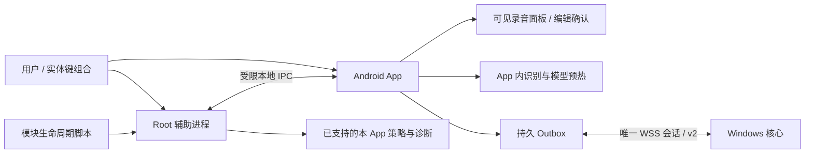

# 语音直达：Root 辅助模块后续方案

记录日期：2026-11-12  
状态：**后续计划，尚未立项实现或进行真机验证**。  
关联方案：[通信协议与低延迟技术方案 v2](01-voicelink-protocol-v2.md)。  
适用对象：已由用户自行取得 Root 权限的 Android 手机；Root 框架及系统版本待确认。

**2026-11-15 最新范围：** 用户要求模块同时提供独立剪贴板采集与应用保活，统一设计见 [56 模块设计](56-root-module-clipboard-and-keepalive-design.md)。两项能力分别启停，普通模式不变；保活不要求本篇原有的限时工作会话，关闭界面后可保持待命，强行停止/无法判定退出原因时暂停自动恢复。本文的实体键、模型预热等仍是未纳入本次范围的历史后续设想；与本文工作会话/重启规则冲突处，以 56 为准。当前 C++ 模块侧采集已在限定 Android 13 arm64 范围实施并验证，见 [60](60-root-helper-native-clipboard-collection.md)；App 读取及保活尚未实现。

2026-11-15 后续决策：用户另行确认剪贴板增强采用「**模块独立采集并持久保存＋SayIn 读取和管理**」，非 Root 手机保持当前单条剪贴板。设计、调研与未验证边界见 [55 剪贴板项目调研第 7 节](55-android-clipboard-projects-research.md#7-对-sayin-的落地方向)。该能力不要求 SayIn 保活，不持有 WSS/配对令牌，也不自动发送；其采集启停和密钥生命周期需单独设计，不直接继承本文的语音工作会话。本文关于不使用 Hook 的限定针对原有快捷入口/恢复原型；剪贴板当前采用 shell UID 原生 Binder 后端，具体边界以 60 为准，不代表已批准任意系统修改。

## 1. 计划背景与决策记录

用户场景是「电脑工作、手机娱乐，需要时立即唤出说话并把最终文字发送到电脑」。普通 App 可能受到 Android/HyperOS 后台管理、网络省电和进程回收影响，表现为入口不可用、连接恢复等待或首句模型冷启动。

用户提出为已 Root 手机制作辅助模块，并于 2026-11-12 要求形成方案、做好记录，作为后续计划。本文件记录技术方向、边界和启动条件；不代表当前已开发、安装或启用模块。

**计划采用普通 Android App + 可选 Root 辅助模块。** 优先验证快捷唤出、工作会话内的异常恢复、局部省电策略和诊断。预计收益主要在后台可用性与首句等待，不能据此声称热连接传输、识别准确率或推理速度已经提升。

| 决策编号 | 当前计划 | 原因 |
| --- | --- | --- |
| ROOT-01 | Root 增强为可选能力，普通 App 独立可用 | 已 Root 手机可增强；基础产品不依赖模块安装 |
| ROOT-02 | 先完成普通模式与测量基线，再启动模块原型 | 先确认实际问题，避免为推测增加常驻进程和系统修改 |
| ROOT-03 | 首版采用模块启动脚本 + 小型原生辅助进程 | 模块机制可提供独立生命周期；暂无证据需要 Zygisk/框架 Hook |
| ROOT-04 | App 独占 WSS、配对、Outbox、识别和消息状态机 | 避免多个进程分别维护连接、补发与输入顺序 |
| ROOT-05 | 录音继续由用户触发，在可见输入面板内开始 | 不把系统录音策略改造作为首版前置条件 |
| ROOT-06 | Root 模式单独验收，不继承普通模式性能成绩 | 不同后台策略、进程与功耗行为需要独立证据 |
| ROOT-07 | 停用、卸载和策略恢复是完整能力的一部分 | 防止停止工作后继续拉起 App 或留下长期系统设置 |

以上是当前设计选择，可在后续证据支持下修改。尚未确定发版时间、工期或全机型支持范围。

## 2. 目标与收益边界

### 2.1 主要目标

1. 手机娱乐一段时间后，仍能通过明确入口较稳定地唤出输入面板。
2. 用户开启工作会话时，减少异常退出、连接恢复和模型冷启动造成的首句等待。
3. 用户能看清 Root 增强是否运行、哪些策略生效、为什么恢复失败。
4. 用户停止工作、停用模块或主动停止 App 后，辅助进程停止相关恢复行为。
5. 保持 v2 的持久确认、过期、焦点保护和不确定结果处理规则。

### 2.2 不承诺的收益

| 事项 | 边界 |
| --- | --- |
| 热连接发送速度 | Root 不会自动缩短已正常工作的 WSS/JSON 链路；必须对比实测 |
| 识别速度与准确率 | 模型预热可减少加载等待，不代表模型推理更快或技术词更准确 |
| 永久后台存活 | Root 进程仍可能退出，网络和系统也可能失效；需要恢复与退出机制 |
| 熄屏网络 | Root 不等于绕过所有 Doze、驱动、厂商策略和断网条件 |
| Wi-Fi 低延迟锁 | root UID 不会自动改变 API 生效条件或无线驱动行为 |
| 无限制后台录音 | 仍涉及权限、AppOps、音频策略、SELinux 和系统版本适配 |
| 所有 Root 框架通用 | Magisk/KernelSU 优先研究；每个宣称支持的组合都需单独测试 |

## 3. 官方依据与设计推论

查阅日期为 2026-11-12。官方能力与本项目推论分开记录。

| 官方资料 | 已确认的机制 | 对本方案的影响 |
| --- | --- | --- |
| Magisk 开发指南 [R1] | 模块可提供 service.sh、卸载脚本等；late_start service 为非阻塞阶段，推荐多数启动任务使用 | 可启动辅助进程；不在阻塞的 post-fs-data 阶段加载模型或等待网络 |
| KernelSU 模块指南 [R2] | 模块结构与 Magisk 相近，但存在框架特有生命周期；当前资料说明仅脚本等用途不要求 system 挂载 metamodule | 可研究共用业务二进制与独立启动配置；不能只在一种框架测试后声明全部可用 |
| KernelSU App Profile [R3] | 可限制 su 派生进程的 UID、组、capabilities 和 SELinux；不自动改变原 App 自身权限 | 辅助进程与 App 是不同权限主体，不能声称给 su 授权就让 App 无限制运行 |
| Android Doze 文档 [R4] | Doze 限制网络并忽略普通唤醒锁；省电豁免只豁免部分限制 | 局部策略调整可能有帮助，但不能等同于关闭全部后台限制 |
| Android FGS 文档 [R5][R6] | 后台启动与 microphone/connectedDevice 服务有类型、权限和系统版本条件 | 继续使用可见面板开始录音；辅助启动是否成功需单独验证 |
| Android WifiManager [R7] | LOW_LATENCY 锁要求连接 AP、屏幕开启和申请 App 前台等条件 | 不默认长期持锁，也不把 Root 当成这些条件已经消失 |

**设计推论：** 模块可提供更独立的入口与诊断路径，并尝试恢复工作会话内的异常服务；实际收益取决于手机 ROM、Root 框架、权限配置及具体实现，当前没有本项目实测结果。

## 4. 能力范围与优先级

| 优先级 | 能力 | 计划做法 | 完成判据 |
| --- | --- | --- | --- |
| P0 | 能力检测与状态展示 | 检测框架、版本、辅助进程连接、当前用户与支持能力 | App 能区分未安装、不可用、待启用、运行中和故障 |
| P0 | 有期限的工作会话 | 用户明确开启，保存会话代次、到期时间及启用能力 | 会话到期、用户停止或重启后不会擅自恢复工作 |
| P0 | 诊断 | 记录退出、恢复、网络与策略状态的脱敏摘要 | 能解释失败原因，不收集输入文字或音频 |
| P0 | 停用与清理 | 结束工作、停止进程、按所有权恢复策略 | 停用后不再拉起 App，不留下不可解释的设置 |
| P1 | 异常退出恢复 | 只在工作会话有效且可确认非用户停止时，有限次请求恢复 | 不形成重启循环，不覆盖 v2 的待确认恢复状态 |
| P1 | 本 App 省电策略辅助 | 按系统能力检测并调整明确支持的本 App 项目 | 只改所选项目，有变更记录与恢复行为 |
| P1 | 实体键入口 | 用户选择的组合触发打开面板 | 不误触发、不改变正常音量/通话行为；冲突时可关闭 |
| P2 | 模型预热 | App 在工作会话内按需加载模型，显示是否就绪 | 冷启动等待减少，内存/能耗代价有测量 |
| P2 | ROM 专项适配 | 仅对有明确测试组合的 HyperOS 行为提供处理 | 有系统版本、问题证据、变更和回归记录 |

P0 是最小可评审原型范围，P1/P2 不因列入本文就自动全部实施。只把经验证确有收益的能力纳入后续版本。

### 4.1 首版不包含

- Zygisk 注入、LSPosed/系统服务 Hook、内核驱动和系统框架补丁。
- 整机关闭 Doze、全局 SELinux permissive、关闭温控或强制锁定高频。
- 通用常驻键盘监听、读取聊天/密码、录音旁路或持续后台录音。
- 把 App 塞进 system/priv-app 并假定自动获得平台签名权限。
- Root 辅助进程独立发送文字、持有配对 token 或绕过桌面焦点保护。
- 为规避后台问题反复执行 force-stop、重装或清除 App 数据。

## 5. 进程架构与职责

| 组件 | 职责 | 不拥有的内容 |
| --- | --- | --- |
| Android App | UI、通知、用户工作意图、录音、识别、Outbox、配对和唯一网络会话 | 不向模块开放任意命令执行 |
| 模块脚本 | 安装检测、适当时机启动、卸载清理入口 | 不在脚本内实现网络协议、识别或无休止轮询 |
| 原生辅助进程 | 生命周期辅助、选定按键、已支持策略、脱敏诊断 | 不保存音频、输入文字、历史和电脑授权 token |
| Windows 核心 | 接受与执行状态、授权、目标检查、输入执行 | 不因为客户端有 Root 就减少任何校验 |

辅助进程可考虑 Rust，与电脑核心共用团队技术经验；只复用合适的基础组件，不为这个小模块提前设计跨平台插件框架。脚本负责生命周期，长期任务采用事件驱动原生进程；首个原型优先验证 arm64，其他 ABI 有明确需求后另行测试。

Magisk 与 KernelSU 共用能力实现的前提是行为一致；启动、停止、环境和权限配置可采用各自必要入口。本文不要求维护旧版本兼容层，也不承诺首次产物即为一个通吃 ZIP。APatch 暂作为候选，当前未做专项调研，不列入支持承诺。

## 6. 工作会话与恢复规则

### 6.1 工作会话状态

| 状态 | 行为 |
| --- | --- |
| inactive | 默认状态；不恢复 App、不监听快捷键、不维持模型 |
| active | 用户开启且未到期；仅启用其选择且已验证的能力 |
| degraded | 某项能力失败；说明具体不可用项，保留正常 App 入口 |
| suspended | 用户主动停止、持续故障或身份校验失败；不自动重启业务 |
| expired | 工作会话到期；清理会话能力，等待用户重新开启 |

会话包含随机 work_id、代次、启用能力及有界期限。默认期限在实测后确定；原型可暂用 30 分钟验证。需要更长工作时段时由用户延长，辅助进程不自行续期。时间以单调时钟及启动代次判断；设备重启一律回到 inactive，禁止用旧墙钟截止时间恢复活跃会话。

模块开机可进入轻量待命，但不得因此自动启动录音、加载模型或补发文字。App 中「结束工作」应先确认辅助进程已停止恢复行为，再完成普通工作会话退出；如果模块不可达，则显示状态未确认，并依赖原有会话到期上限停止，不能假报已停用。

### 6.2 异常退出与用户停止

恢复前须同时满足：有效工作会话、对应能力已启用、用户及 App 身份匹配、没有停止标记、没有超过恢复预算、当前状态允许请求启动。

普通进程回收与用户 force-stop/系统「停止」不是同一件事。后续原型必须验证可用的 package/process 状态是否能可靠区分；若只能知道进程消失，**不实施无条件自动拉起**，降级为入口触发或状态提示。用户在 App 内结束工作、在模块管理器停用模块，以及可识别的系统停止行为，都应抑制恢复。

恢复采用有限预算与退避，原型可用「10 分钟内最多 3 次」作为保护参数；超限进入 suspended 并说明原因。使用 IPC 断连等事件做检测，不用高频 shell 循环遍历进程。辅助进程自身也要限制重启，禁止 App 与守护进程互相无限拉起。

恢复 App 仅请求它进入恢复/待命流程：恢复 Outbox 后先按 v2 查询状态，旧草稿、过期请求和 uncertain 不自动变成新提交。恢复成功不代表录音已开始、模型已就绪或网络已连接，各项分别报告。

## 7. 本地 IPC 与权限边界

首个原型优先验证 Unix domain socket，实现结构化、大小有界的本地请求；不监听局域网或额外 HTTP 端口。socket 的命名空间、文件权限、SELinux 标签与可达性需真机验证；使用 abstract socket 也不能假设其他 App 无法访问。

辅助进程使用 SO_PEERCRED 等机制获取真实对端 UID，并与系统查询得到的包名、当前 Android 用户和允许的签名证书摘要绑定。身份信息不能只相信请求体自报；隔离进程、工作资料、多用户、卸载重装与 UID 重用都需覆盖。校验过程不确定时拒绝特权操作。授权签名变更由后续发布策略明确处理，不能自动接受任意新签名。

### 7.1 拟开放的固定操作

| 操作 | 用途 | 约束 |
| --- | --- | --- |
| get_capabilities | 读取支持能力和版本 | 只返回必要信息，未支持能力不伪成功 |
| get_status | 读取工作会话与故障状态 | 不含输入内容或历史 |
| start_work | 开启有期限的增强会话 | 必须来自已验证 App，并由 App 的明确用户操作触发 |
| stop_work | 幂等结束增强会话 | 高优先级，停止恢复、按键与预热请求 |
| set_key_trigger | 设置一个支持的按键组合 | 只在工作模式生效，限制候选键与冲突场景 |
| apply_supported_policy | 调整已检测支持的本 App 策略 | 无任意包名、命令或路径参数 |
| restore_owned_policy | 恢复模块拥有的设置变更 | 按变更账本与当前值检查执行 |
| collect_diagnostics | 导出脱敏状态摘要 | 有界大小、不采集输入文字和全量按键流 |

start_work 不能仅靠「调用方是合法 App」就声称系统已经验证真实点击；用户意图由 App UI 与会话设计表达。实现需要请求 ID、短超时、有界队列、每调用方限速及 work_id/代次校验，拒绝旧会话延迟到达的变更；协议版本不符时停用增强，普通 App 继续工作。

App 不传 shell 字符串、任意文件路径、任意 PID 或待执行二进制。需要调用系统工具时使用固定参数与直接进程执行，不能拼接用户输入。Root 权限尽量只留给必要操作；诊断、预热与 UI 不因有模块而整体转为 root 执行。需要的 SELinux 规则按实际访问最小化配置，保持 enforcing。

## 8. 省电策略、实体键与模型预热

### 8.1 省电策略

先检测普通 App 可获得的省电豁免是否已经足够，再评估模块辅助配置。只处理明确支持的本 App 项目；HyperOS 自有管理策略需要按系统版本核实，找不到可靠接口就显示手动设置指引。

每次变更记录：设置对象、原值、模块写入值、时间、work_id 与恢复策略。结束或卸载时，仅在当前值仍等于模块写入值、且该项确由模块拥有时恢复；用户原本就配置的豁免不删除。出现并发更改或原值未知时保留并提示，不盲目覆盖用户新设置。

卸载脚本不能被当成一定执行的事务保证。辅助进程正常退出负责清理，崩溃后下次可运行时检查未完成账本；优先选择有期限/可逆设置。停用标记不一定会立即终止已启动进程，因此原型必须验证管理器的实际行为，并补齐运行中停止机制。无法保证清理的持久 ROM 修改不纳入首版。

### 8.2 实体键入口

第一阶段只验证用户主动选定的少量组合，例如长按某个可用键或双击组合。输入源识别、去抖、按下/抬起配对、耳机/蓝牙、通话、锁屏和游戏冲突均需测试。

读取输入设备不等于已经能独占或拦截系统按键。先验证不独占监听的方案；若系统也处理了按键，应明确说明副作用。未经验证不使用全局 EVIOCGRAB 等方式吞掉正常按键，不能以牺牲音量/电源键可靠性换取入口。监听范围只保留选定触发事件，不保存完整输入流。

触发效果是请求 App 打开可见输入面板。锁屏默认不解锁、不自动录音；系统拒绝拉起时反馈失败并保留通知/App 入口，不循环抢前台。具体按键选择与是否按住录音，等真机试用后决定。

### 8.3 模型预热

App 负责加载和释放模型，模块仅传递工作会话状态与按需唤起。没有可用输入面板或不满足生命周期条件时，预热失败不触发系统限制绕过。预热不是录音，不能顺带启动麦克风。

比较「无预热」「工作时段预热」「空闲后卸载」的首句耗时、RAM、温度与能耗。模型驻留期限依据数据决定；用户结束工作或内存压力过大时允许释放，不为零冷启动永远占用模型。若普通 App 已能获得相同收益，就在普通模式实现，不制造 Root 依赖。

## 9. 与 v2 协议的关系

首期网络端点、配对、消息结构、顺序、焦点检查及持久状态无需因模块新增而改变。Root 是手机端本地增强，Windows 不授予它额外权限。

- 唯一 Outbox 与 WSS 会话仍由 App 管理；模块不能创建第二套补发队列。
- 请求 ID、原始 payload、过期与 uncertain 行为遵循 v2；模块恢复进程不是重新发送授权。
- App 切换到 Root 增强模式不重置授权、序号或收据，也不自动清理本地待处理内容。
- 模块异常时增强降级，已执行状态不伪装为失败重试；App 正常网络路径不等待模块健康检查。
- 一次快捷键触发只产生唤出意图；用户完成录音和确认后才产生 submit。

未来若确有证据需要由独立进程持有连接或模型，应另做进程所有权、凭据存储、持久事务和故障恢复评审。本文不预先建立这一套复杂架构。

## 10. 后续实施阶段

| 阶段 | 工作内容 | 产物与进入下一阶段的条件 |
| --- | --- | --- |
| A：普通模式基线 | 完成普通 App 主链路；测量娱乐后唤出、首句、重连及功耗 | 可复现的问题、日志与对照数据；没有明确问题则暂缓模块 |
| B：最小辅助原型 | 在用户实际 Root 框架测试启动、IPC、身份校验、状态展示和停止 | 能正常启停与清理，不修改录音策略、不 Hook 框架 |
| C：恢复与策略 | 分别验证有限恢复、本 App 策略检测和回滚 | 能区别用户停止；失败有界、变更可追踪 |
| D：快捷入口与预热 | 单独评估按键及模型预热收益 | 快捷键不干扰日常使用；预热收益足以解释资源成本 |
| E：支持范围与验收 | 在明确的系统/Root组合完成回归与对照 | 公布实测结果、支持矩阵、限制和停用说明 |

此顺序是后续任务拆分，不是当前已完成清单。具体实现启动后再建立代码任务、版本和时间安排。

## 11. 验证计划与验收条件

### 11.1 对照场景与记录

同一手机、ROM、网络和 App 版本分别测试：普通模式、安装但停用模块、启用单项能力、启用预期组合。避免把换路由器、模型版本或省电设置造成的差异算成 Root 收益。

| 维度 | 必测场景/指标 |
| --- | --- |
| 环境 | 实际机型、Android/HyperOS构建号、内核、Root框架/版本、App/模块提交、权限与策略 |
| 唤出 | 前台、娱乐App前台、游戏、锁屏、熄屏10/30/60分钟；成功率和p50/p95/p99 |
| 首句 | 入口触发→面板可见、模型就绪、网络可提交、最终输入结果，分段测量 |
| 恢复 | 普通回收、崩溃、force-stop、系统停止、App结束工作、模块停用、重启 |
| 系统变更 | OTA、App更新、卸载重装、签名不符、多用户、Root权限撤销 |
| 资源 | CPU、RSS、唤醒次数、温度、异常恢复次数、同条件持续时段能耗 |
| 协议回归 | 原ID去重、过期不补打、uncertain不重试、焦点不符held、暂停控制可用 |

关键唤出场景初始至少100次；功耗按同条件可重复时段多轮比较，公布时长与测量方法。保留失败、超时及重试样本，不只统计成功的快样本。热连接 p95<80 ms 等指标沿用 v2 的严格口径，不能把唤出、ASR和用户确认等待混入或移出以制造改善。

### 11.2 功能验收门槛

1. 不受信任UID、签名不符、旧work_id、畸形/超大IPC请求不能触发特权操作；拒绝后资源保持有界。
2. 工作会话到期或用户主动结束后，不再恢复 App、监听触发或请求模型驻留；设备重启不自动恢复旧工作会话。
3. 用户明确停止与异常回收的区分通过验证；若无法可靠区分，则自动恢复能力不启用。
4. 故障达到预算后进入suspended，模块与App不互相无限拉起；网络断开不误判为需要重启整个App。
5. 停用/卸载后无遗留业务进程和输入监听；策略按所有权恢复，不删除用户原有配置或覆盖新修改。
6. 模块恢复不会自动录音、解锁或重新提交旧文字；v2的去重、过期、焦点与uncertain故障用例继续通过。
7. 仅宣称经测试的框架/ROM组合可用；发现ROM专项接口变化时明确降级，不在运行时猜测执行系统修改。
8. 提供普通模式与增强模式的完整对照结果。收益不足或能耗成本过高的能力保持关闭，不因已有代码就列为默认。

性能改善幅度和允许的额外功耗须在阶段A建立基线后确定。当前不填写未经测量的「提升百分比」「全天耗电」或「永不被杀」。

## 12. 实施前信息与持续记录

### 12.1 实施时需确认的信息

| 项目 | 当前记录 |
| --- | --- |
| 目标手机实际Android/HyperOS构建 | 待实施时读取；不由机型推断 |
| Root框架和版本 | 待确认，先支持实际使用的一种 |
| Root/SELinux/输入设备可用能力 | 待真机检测 |
| 当前最明显的问题 | 待普通模式基线确认：入口、连接、冷启动或其他 |
| 希望使用的实体键组合 | 待用户试用确认 |
| 工作会话时长与能耗取舍 | 待基线及原型比较后确定 |
| 应用包名与授权签名摘要 | 当前未确定，实施后记录真实值 |

这些信息不会阻止当前方案记录完成，但决定后续模块如何实现及支持哪些能力。

### 12.2 后续实验记录模板

每次原型实验追加记录，不用后来的设想覆盖既有测量：

| 字段 | 内容 |
| --- | --- |
| 实验编号/日期 | 待填写 |
| 假设与问题证据 | 具体故障、复现方式与预期改善 |
| 环境与提交 | 手机/ROM/Root/网络/App/模块版本 |
| 启用能力与实际变更 | 单项开关、策略原值和写入值 |
| 对照与采样 | 普通/停用/增强，各自次数与持续时间 |
| 结果 | 原始样本、成功率、分位数、资源、失败原因 |
| 停用和恢复验证 | 进程、按键、系统设置是否清理 |
| 决策 | 保留、默认关闭、调整或删除，以及理由 |

### 12.3 本次记录

| 日期 | 事项 | 结果 |
| --- | --- | --- |
| 2026-11-12 | 用户提出已Root手机的模块辅助方向 | 完成可行性讨论，定位为可选增强 |
| 2026-11-12 | 用户要求编写方案并作为后续计划记录 | 创建本文，记录范围、决策、阶段、风险边界和验收方法；未实施模块 |

## 13. 官方参考资料

- **[R1]** Magisk，[Developer Guides](https://topjohnwu.github.io/Magisk/guides.html)：模块结构、启动脚本、生命周期与Zygisk区别。
- **[R2]** KernelSU，[Module guide](https://kernelsu.org/guide/module.html)：模块生命周期、与Magisk差异，以及system挂载的metamodule要求。
- **[R3]** KernelSU，[App Profile](https://kernelsu.org/guide/app-profile.html)：su进程权限、原App权限与SELinux边界。
- **[R4]** Android，[Optimize for Doze and App Standby](https://developer.android.com/training/monitoring-device-state/doze-standby)：网络/唤醒锁限制和局部省电豁免。
- **[R5]** Android，[Restrictions on starting a foreground service from the background](https://developer.android.com/develop/background-work/services/fgs/restrictions-bg-start)。
- **[R6]** Android，[Foreground service types](https://developer.android.com/develop/background-work/services/fgs/service-types)：microphone、connectedDevice等服务的条件。
- **[R7]** Android，[WifiManager / WIFI_MODE_FULL_LOW_LATENCY](https://developer.android.com/reference/android/net/wifi/WifiManager#WIFI_MODE_FULL_LOW_LATENCY)。

官方资料说明机制与限制；本文的辅助进程、IPC、工作会话和阶段安排是本项目后续设计，尚未经过手机实测。
