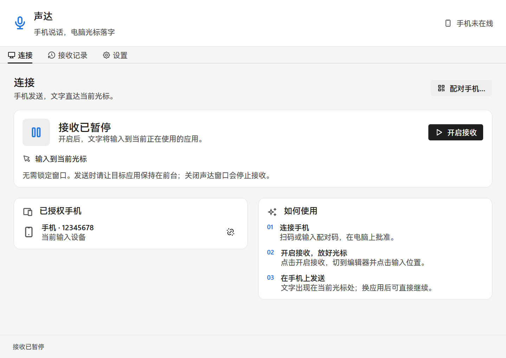
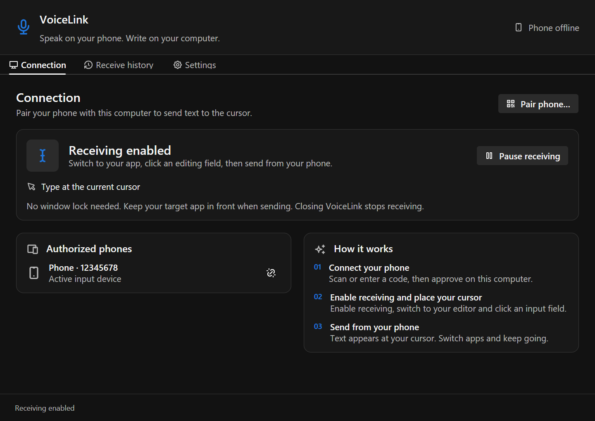

# 13 · 电脑端当前光标交互与界面重做

日期：2026-11-12。本文替代早期实施记录中的“锁定窗口、倒计时切换”操作说明。

## 新操作流程

1. 手机扫码或输入配对码，电脑批准。
2. 在电脑端点 **开启接收**。
3. 切到编辑器、聊天框等目标应用，点击输入位置。
4. 在手机输入并确认发送，文字进入电脑当前光标处。
5. 换应用时直接点击新的输入位置；需要停用时点 **暂停接收**。关闭电脑端窗口会停止接收。

开启接收时无需选择窗口，也没有倒计时。电脑端自己位于前台时仍可开启；具体发送时若前台是声达自身，则拒绝输入，需切到目标应用。

## 参考与取舍

研读本机 `new-project/refer/tranvoice-master/src/pc/win32-injector.js`：其核心习惯是向当前前台窗口输入，不要求用户提前锁定窗口。借鉴这一交互；保留本项目有保护的 Unicode 批量 SendInput，不引入剪贴板覆盖、Ctrl+V、进程调用、固定睡眠或正文日志。

## 实现边界

- `NativeInput.preflight` 为每次操作捕获前台窗口句柄、进程、进程创建时间和活动会话，并关联 device/request/scope。执行标记提交后和 SendInput 前后均核对；同一请求中途失焦不能悄悄改投另一个窗口。
- 权限、输入桌面、修饰键、最小化和本进程检查保留。不抢焦点、不追加回车。全局输入无法原子锁住 Windows 前台切换，仍存在检查与输入之间的极短竞态；部分输入/事后失焦按 uncertain 处理。
- 本地开启接收创建新的 activation scope，协议字段仍叫 `target`。手机远程恢复不能凭空建立这个范围。
- 暂停后重新本地开启会换 scope。手机同 scope 恢复也不自动释放旧请求。旧请求不自动改投新光标；保留 held，需逐条明确释放或取消。uncertain 必须电脑本地明确核对，不自动重放。
- generation fence 保留：后到的暂停能阻止较早排队的开启请求。

## 界面变化

接收状态与播放/暂停控制合为一张卡片；已授权手机、三步指引、配对、网络许可、记录与设置均使用 Yue 卡片和 Tabler 图标。限制正文最大宽度；配对操作展开时优先展示网络和二维码区域。顶部手机状态来自连接快照，设备列表只标识授权/当前输入身份，避免把整体在线数当成每台手机在线状态。保留公用网络本次会话授权与撤销确认。

切换接收状态时使用稳定控件 ID，保持焦点，可连续按空格暂停/开启。语言与主题选择保留状态、焦点和持久化；横向单选组用左右键。

## 验证

- Rust 工作区 all-targets：**67 项通过**；包含首次本地开启、旧修订拒绝、新 scope 隔离旧请求、不确定回执核对、暂停并发屏障、真实 Shell 指针和空格操作。
- `cargo clippy --workspace --all-targets --locked -- -D warnings`、包限定 fmt、工作区 build、i18n、依赖图与相邻 Yue 源摘要均通过。
- 原生 Windows GPUI/D3D 渲染 **33 帧**，覆盖中英文、深浅色、960×680 / 720×540 及三个生产页面。示例只使用一次性离线手机身份，不监听网络、不发送输入。
- 二维码原生渲染解码 **18 帧**，三份独立邀请，深浅色及三档 rem 均匹配。
- 没有完成普通目标应用真实落字、手机光学扫码或物理 Wi-Fi 延迟实测；不能据以上结果声称这些已通过。

证据：[实施 JSON](research/13-current-cursor-verification-2026-11-12.json)。命令及日志在 `desktop/interaction-{test,clippy,build,native,qr}.log`。

## 真机验收步骤

1. 打开新版电脑端，手机连接同一网络；扫码/短码任选其一，电脑批准。公用网络只需在本软件明确授权本次会话，无需修改 Windows 网络类型。
2. 电脑点开启接收，再切到普通权限记事本，点击正文。手机发送 `声达 current cursor 123`，核对只出现一次、不带回车。
3. 切到另一个普通权限文本框，发送另一句，核对跟随新光标；无需返回电脑端锁定。
4. 暂停后发送应不可用；重新开启不会自动重发旧请求。历史中 held 按实际需要逐条处理。
5. 发送时若电脑仍停留在声达界面，应保留待处理/拒绝输入，不把文字写进配置界面。切回目标应用后遵照记录操作，不盲目重复发送。
6. 若显示 uncertain，先核对目标中已有文字，再在电脑本地确认；不要自动补发整句。
