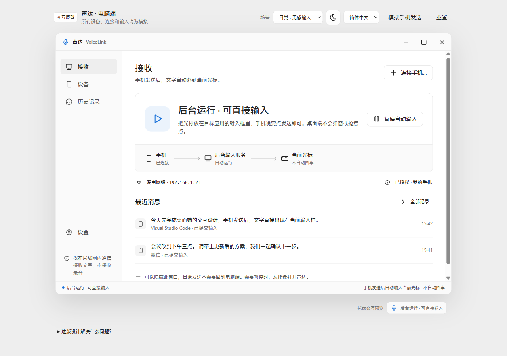
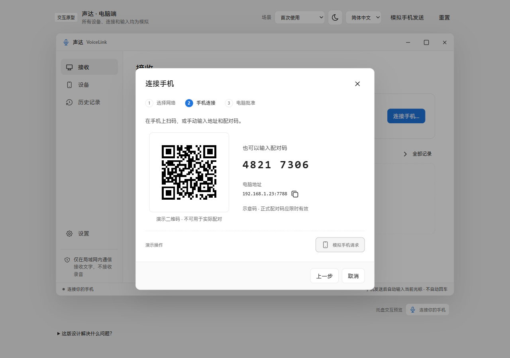
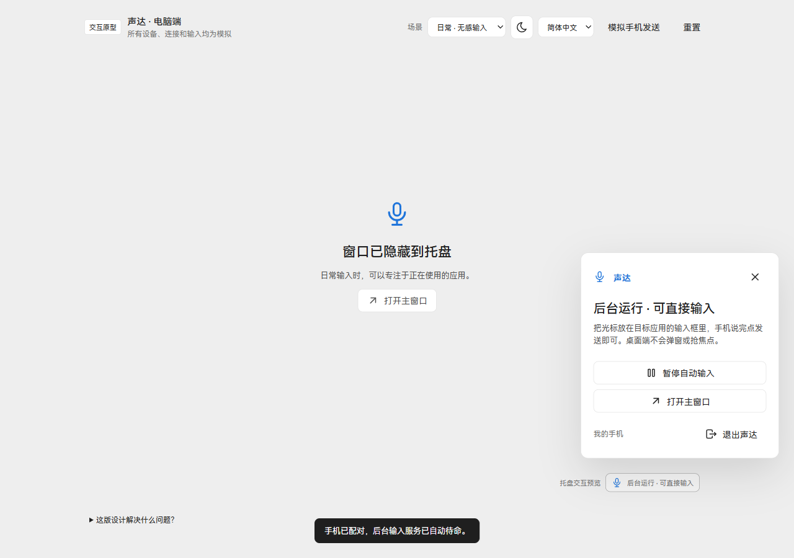
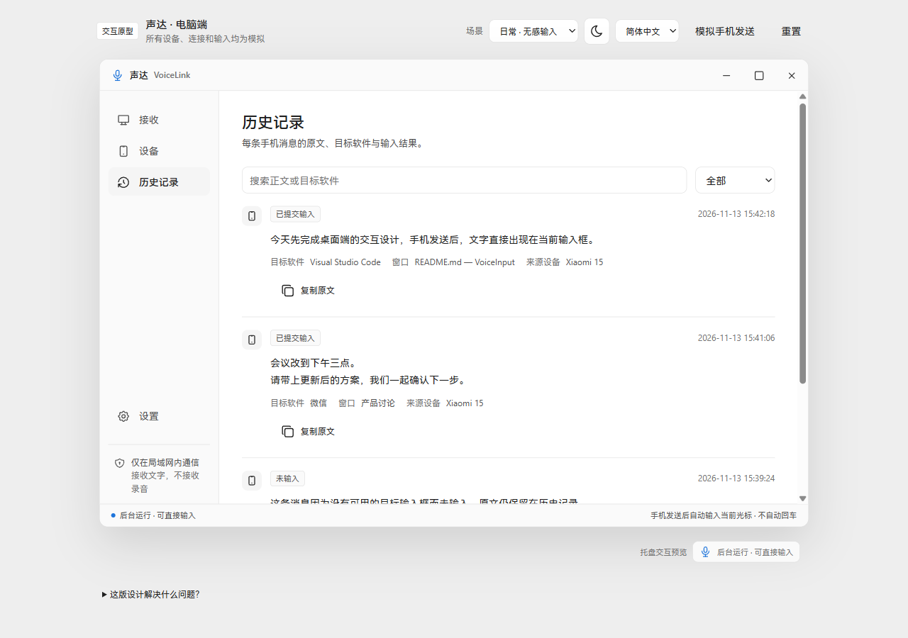

# 15 · 桌面端的用途、任务与 UI 原型

日期：2026-11-13。状态：产品与交互原型；原生 GPUI 的后续落地与验证见 [16 · 桌面端重构实施记录](16-desktop-ui-refactor-implementation.md)。下文保留原型阶段的设计范围，实际支持项以实施记录为准。

原型：[打开单文件 HTML](demos/voicelink-desktop.html)。不需要构建；图标、样式、脚本及演示二维码均已内嵌。

## 1. 桌面端为什么存在

用户想完成的任务是：**在手机上说话并发送，文字自动进入电脑当前聚焦的输入区域。** 用户真正工作的地方通常是编辑器、终端或聊天框。

桌面端承担手机和普通网页不能代替的本机职责：

| 职责 | 用户获得的价值 | 界面需要回答的问题 |
| --- | --- | --- |
| 连接与授权 | 只接受用户允许的手机 | 哪台手机连着？如何添加或撤销？ |
| 本机输入 | 在后台把手机发送的文字注入电脑当前光标 | 手机发送后是否会自动出现？是否抢焦点？ |
| 暂停与恢复 | 用户可以主动停止输入 | 哪里能立即暂停？恢复会不会重发旧文字？ |
| 结果与恢复 | 断线、失焦或崩溃后保留可核对状态 | 这条请求处理到哪一步？需要我做什么？ |
| 常驻与访问入口 | 不必在工作时一直打开控制窗口 | 窗口藏起来后还接收吗？如何找到它？ |

因此，桌面端是**安静常驻的后台输入服务**。配对后它不参与每条文本的确认，手机发送即触发注入，同时在后台保存消息正文与目标软件。主窗口承担配置、历史查阅、暂停和异常处理。界面应让用户几乎感觉不到桌面端的存在。

这一定位来自原始对话中对无麦克风电脑、原生 GUI、托盘常驻和局域网输入的需求，并结合目前已经实现的接收核心与手机端。原始对话中列出的热词、常用语、文本整理、回退文字等想法仍需单独评估；不因曾被提到，就全部放进首屏。

## 2. 无感输入的硬约束

这条约束决定桌面端的架构和 UI：

- 手机点击“发送”就是用户对本条文字的最终确认，桌面端不得再次弹窗、预览或要求确认。
- 桌面端进程在后台接收局域网消息，直接调用系统文本注入能力，把文字提交给执行输入时经过核对的当前前台输入控件。
- 注入过程不激活桌面端窗口、不移动用户焦点、不追加回车；用户继续停留在编辑器、聊天框或终端。
- 窗口只用于低频管理：首次配对、暂停/恢复、异常核对、设备撤销和设置。每条消息不经过窗口。
- 每条来自手机的消息自动保存完整正文、时间、来源设备、目标软件/窗口和处理结果。记录不要求用户确认，不弹窗、不抢焦点。

因此，“手机发送 → 局域网 → 后台输入服务 → 当前光标”是唯一的日常路径；“打开桌面窗口 → 查看文字 → 点击确认 → 再输入”属于错误交互。

## 3. 双端分工与操作频率

| 用户行为 | 主要发生的位置 | 频率 | 桌面界面的响应 |
| --- | --- | --- | --- |
| 说话、编辑、确认发送 | 手机 | 高频 | 展示必要接收状态，不要求回到电脑端操作 |
| 放置光标、检查和编辑结果 | 目标应用 | 高频 | 不抢焦点，不要求手动锁定窗口或倒计时 |
| 看状态、暂停接收 | 托盘快捷面板或主窗口 | 日常偶发 | 保持一个直接可见的暂停入口 |
| 配对、首次批准 | 电脑主窗口 + 手机 | 低频 | 独立短流程，结束即收起 |
| 撤销授权、换网络 | 电脑主窗口 | 低频 | 显示对象、作用范围和操作后果 |
| 核对不确定结果 | 目标应用 + 电脑主窗口 | 异常情况 | 突出核对动作，禁止自动补打 |
| 语言、外观、关闭行为 | 设置 | 低频 | 放入设置，不占用接收页 |

主流程：**首次配对并授权 → 切到目标应用并放置光标 → 手机说话并发送 → 文字自动落到当前光标。**

配对成功后后台服务自动待命，用户不需要再回到电脑端点击“开启”。重新打开程序也自动恢复后台服务；只有用户主动暂停、网络变化或结果不确定时才停止注入。用户在两条独立请求之间切换应用，不需要返回声达窗口；失焦防护由接收核心负责。

## 4. 三种界面，分别承担不同任务

### 托盘快捷面板

展示手机/后台输入服务状态，以及“暂停自动输入 / 恢复自动输入”“打开主窗口”“退出声达”。异常时替换为核对入口，离线或网络失效时不提供可误操作的恢复按钮。

隐藏窗口保持原接收状态；退出则停止接收。默认第一次关闭时明确提供这两个选择，设置中可选择每次询问、隐藏至托盘或退出。托盘保持可访问，避免主窗口消失后用户找不到暂停入口。

**这是原型阶段提出的目标行为。后续原生实现已修改应用与窗口生命周期，加入托盘及三种关闭偏好，详见第 16 份实施记录。**

### 主窗口

四个稳定入口：

| 入口 | 内容 | 主要操作 |
| --- | --- | --- |
| 接收 | 后台输入状态、手机到当前光标的路径、最近两条活动 | 暂停/恢复自动输入、连接手机、异常核对 |
| 设备 | 授权与在线状态、当前输入设备 | 添加手机、确认撤销 |
| 历史记录 | 每条消息的完整原文、目标软件/窗口、来源、时间与结果 | 搜索正文或软件、筛选结果、复制原文、核对异常 |
| 设置 | 外观、语言、关闭行为、输入与隐私规则 | 即时调整偏好 |

接收页的阅读顺序为：后台服务状态 → 手机发送到当前光标的路径 → 必要连接信息 → 最近活动 → 需要用户处理的异常。日常页不把“桌面端接收每条文字”设计成操作步骤。避免把服务结构、权限说明、完整配对表单和使用教程同时铺满首屏。

默认窗口为 1000 × 660，紧凑窗口为 720 × 540。窄窗口保留主操作，辅助内容在主内容区滚动，导航与接收状态栏保持稳定。HTML 标题栏只是窗口样式示意，真实拖拽、最大化和系统缩放仍须原生实现。

### 临时配对对话框

三步：

1. 选择与手机相连的网络。公用网络需要本次会话明确授权，无需强制修改 Windows 网络类型。
2. 展示二维码与短码。它们是二选一的连接方式，同屏展示便于选择，不要求都做一遍。
3. 在电脑批准手机。批准后回到接收页，后台输入服务自动待命，下一次手机发送即可落字。

取消对话框不改变正在使用的网络；切换网络选项清除原勾选的公用网络许可。更换网络的编辑状态与当前有效状态分开。

HTML 中二维码为 `voicelink-demo://not-a-real-pairing` 的图案，短码固定为示例值，均不能用于产品配对。“模拟手机请求”是独立标出的演示控制，不属于正式产品操作。

## 5. 状态决定界面，而不是长期堆提示

| 状态 | 主信息 | 允许的下一步 |
| --- | --- | --- |
| 首次使用 | 连接你的手机 | 打开配对 |
| 已连接、暂停 | 自动输入已暂停 | 恢复自动输入；不会重发暂停期间的旧请求 |
| 后台运行 | 手机发送后文字自动进入当前光标 | 暂停，或隐藏窗口继续工作 |
| 手机离线 | 授权保留，等待重新连接 | 管理设备或重新配对；不显示可开启的按钮 |
| 正在连接 | 明确等待状态 | 不提前显示连接成功或输入就绪 |
| 网络变化 | 自动输入暂时停止 | 重新选择/授权网络；服务恢复待命 |
| 结果不确定 | 自动注入暂停，需要核对 | 查看请求信息，核对目标，明确恢复 |

状态通过文字与图标共同表达，不依赖红绿颜色。不显示未经实测的时延、速度、吞吐、在线数量或“输入成功率”。

“已提交输入”代表桌面端已经向目标控件提交输入事件；它仍不保证目标应用已渲染成功。核对 uncertain 后保留原不确定回执，新增核对动作记录，不把历史结果改写成成功。

旧的 held 请求仍需要逐条处理。此原型集中演示 uncertain 核对，不模拟完整持久队列；正式重构必须保留当前手机端 release/cancel 与接收核心的保守恢复规则。

### 消息历史与目标软件（用户确认的新增要求）

桌面端必须记录**每条手机发送的完整文本**，并记录它输入到哪个软件、哪个窗口。无论输入完成、失败、暂停待处理或结果不确定，都保留对应正文及真实状态；不能只留成功消息或状态摘要。

| 字段 | 语义 |
| --- | --- |
| 消息标识 | 按电脑、授权设备与请求 UUID 识别；同一请求重传更新同一条记录，不重复追加。用户主动再次发送相同正文则是另一条消息 |
| 完整原文 | 保存手机发送的最终正文，保留换行与标点；切换界面语言不能翻译或修改原文 |
| 时间 | 分别保存手机发送时间、电脑收到时间及实际执行时间；设备时钟可能不同，不混为一个本机时刻 |
| 来源设备 | 保存来源设备 ID 和当时的显示名称；撤销设备授权不会抹掉已有历史 |
| 目标软件 | 在执行输入时记录经过核对的实际前台进程身份、软件名称与窗口标题快照；不能用用户打开历史页时的软件来补填 |
| 处理结果 | 区分待处理、已提交输入、未输入和结果不确定；核对动作另存，保留原始结果 |

目标软件信息来自**执行输入时已核对的目标上下文**，复用接收核心的前台窗口、进程身份和焦点核对，不能仅凭窗口标题判断身份。输入前发现焦点变化时停止该次输入；同一请求中途变化时保留结果不确定及各次尝试对应的目标，不能保证最终渲染或彻底消除系统焦点竞态。未实际执行的消息不宣称“已发送到某软件”；没有取得目标则显示“未获取目标”。

网络尚未传到电脑的消息仍在手机 Outbox，电脑不能凭空生成其正文历史。电脑收到并认证消息后即进入历史流程，状态随后更新；手机离线队列与桌面记录以请求身份关联。

正式落地时正文在本机持久保存，使用 Windows 当前用户保护机制保护静态内容；常规日志不写正文。历史由后台协调线程维护，查询分页/按需加载，GUI 不在主线程写库，也不把历史全表扫描放进新消息接受路径。历史留存与协议去重收据分开管理，日后清理正文不能破坏去重或导致旧消息再次注入。收到、写入记录、提交输入和持久回执的事务顺序需在接收核心实施时一起设计与验证。

HTML 的“历史记录”页已演示完整正文、目标软件和窗口、发送时间、来源设备、结果筛选、正文/软件搜索与复制原文；首页仅展示最近两条摘要。顶部“模拟手机发送”是评审控件，模拟已配对手机发来消息并自动记录，目标软件为固定示例。演示正文仅存在页面内存，刷新重置；本次未实现原生持久化、进程识别或系统输入。

## 6. 视觉、文案与键盘

- 保持 `#1f75db` 主题色，其余使用 Yue tokens 的 neutral 系列。品牌用于少数主操作与接收状态，其余通过字号、间距和边界建立层级。
- 以 Yue 能落地的基础控件组合为参考，单一 Tabler 图标体系。HTML 是交互验证载体；正式应用继续使用用户指定的 Yue-GPUI-Component，不因此迁移 Web 技术栈。
- 日常页面保留一个主要状态区域，活动用简单行列表，不给每行套卡片。配对与批准仅在当前决策时出现。
- 操作使用有标签的按钮；标题栏图标和小屏折叠导航有无障碍名称。鼠标箭头遵循桌面习惯。
- 支持简体中文、English，以及跟随浏览器系统语言；外观支持深浅色和跟随系统。原生落地继续使用现有 Fluent/Windows 偏好设计。
- Tab 顺序跟随布局；Space 操作按钮，切换暂停状态后保留焦点；Escape 关闭对话框/托盘面板，并回到发起控件。公用网络和不确定结果都需要显式勾选后才能提交。
- 原型设置只保存在当前页面内存中，刷新即可重置。没有写入系统偏好、启动项或实际设备凭据。

## 7. 如何评审 demo

1. 打开 [HTML](demos/voicelink-desktop.html)。顶部控件是评审工具，与下方产品窗口分开。
2. 默认查看日常接收页，确认页面表达的是“手机发送后自动落字”；尝试暂停与恢复，点标题栏最小化后操作右下角托盘面板。
3. 选择“首次使用”，完成网络 → 二维码/短码 → 模拟手机请求 → 电脑批准。
4. 选择“输入结果不确定”，查看核对流程；不勾选核对声明时无法恢复。
5. 打开“历史记录”，查看正文、软件和窗口信息，搜索正文或软件、复制原文并筛选结果；顶部点“模拟手机发送”，确认自动增加记录，不打开确认弹窗。切换语言时正文不变。
6. 查看设备撤销、网络变化后恢复，以及隐藏和退出的区别；撤销授权仍保留原有消息记录。
7. 切换中英文、深浅色；点标题栏方框切换紧凑窗口。

评审重点：打开窗口是否能立即知道当前状态和下一步；日常使用是否能离开主窗口；配对是否足够短；异常处理是否让人理解后再操作。

## 8. 验证与实施边界

本次仅新增本方案、HTML、素材来源清单与预览图，没有替换 Rust/Android 生产界面。

浏览器验证包含：

2026-11-13 消息历史修订已重新检查正常/紧凑窗口的 224 组语言、主题、场景与页面组合，无横向溢出和脚本异常。实测通过正文/软件搜索、空结果、未输入筛选、原文复制、语言切换原文不变、模拟发送不弹确认即增加记录、撤销授权保留历史、不确定结果核对后保留原文与原结果。配对后直接待命、隐藏窗口与托盘暂停也已回归。软件身份获取、本机持久化和真实输入仍未实施。

- 正常/紧凑窗口各 112 个页面状态组合：2 种语言 × 2 种主题 × 7 种状态 × 4 个页面。检查内容区横向溢出；常规窗口另检查图标引用和可见按钮无障碍名称。另检查 720px 浏览器宽度的四个页面。
- 实际点击/键盘完成暂停恢复、配对本机批准、切换接口后许可清除、撤销确认、Escape 焦点返回、不确定结果显式核对、保留原回执、托盘暂停与返回、退出与重开。
- 检查关闭偏好、系统语言/主题选择、取消网络表单不改变有效网络、网络恢复后服务回到待命、记录筛选。
- 检查浏览器无脚本错误；图标、二维码、样式和脚本均内嵌，页面加载后没有额外网络资源请求。

验证通过本机回环 HTTP 预览运行。自动浏览器工具禁止 `file:` 导航，因此没有把工具中直接双击文件的运行描述为已验证。HTML 的结构不依赖 HTTP 服务，复制单文件即可用于评审；复制地址受浏览器剪贴板权限限制，失败时提示手动选择。

这些结果是 HTML 原型的交互和布局证据，不是 Yue 原生组件、托盘生命周期、真实扫码、真实局域网输入或延迟性能的验收。

素材与 token 来源：[清单](demos/voicelink-desktop.assets.json)，Tabler 许可：[MIT](demos/Tabler-LICENSE)。浏览器验证摘要：[JSON](research/15-desktop-ui-prototype-verification-2026-11-13.json)。

正式重构顺序建议：先实现无窗口后台接收、当前焦点文本注入和托盘生命周期，再替换四个页面与配对对话框，最后用原生状态、键盘、缩放和真实输入完成回归。每条消息的路径必须是“手机发送 → 局域网 → 后台服务 → 当前光标”，不能要求用户回到桌面窗口确认。
