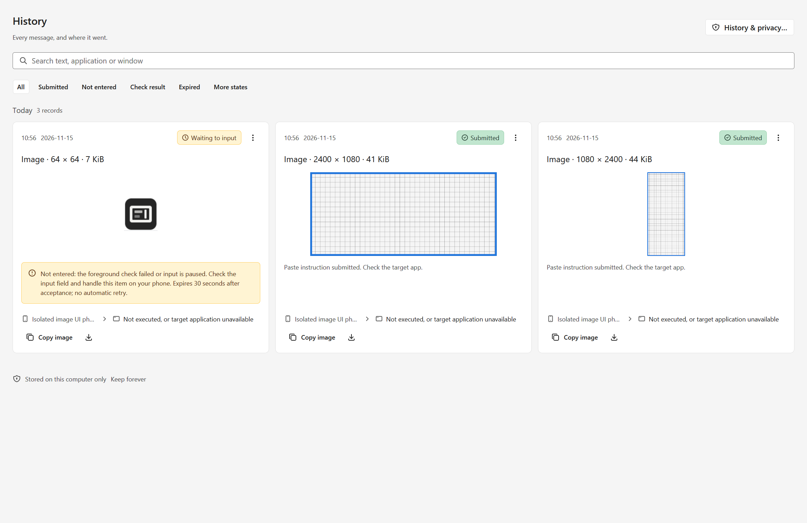
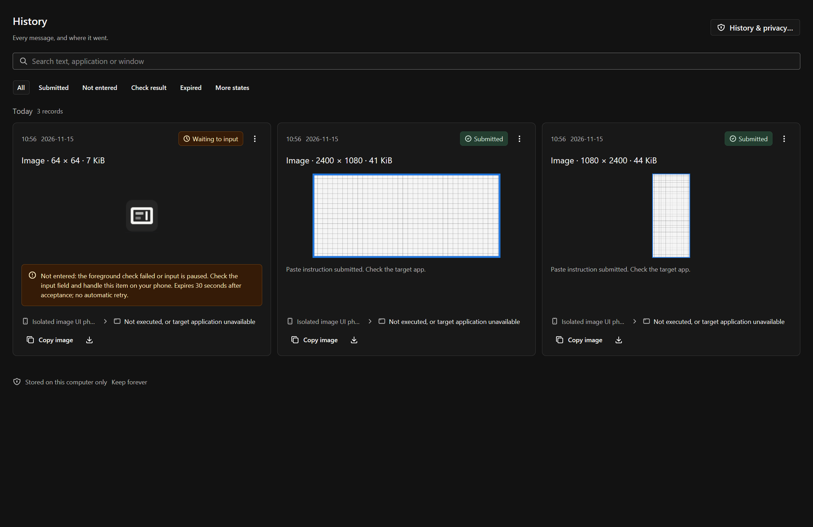

# 47 · 电脑图片历史卡片渲染修复

日期：2026-11-15。修复基线为已推送阶段 5 的 `4b28edf`。这是阶段 5 的独立界面回归修复，不是阶段 6 全部图片验收完成声明。

## 问题与根因

用户在独立数据目录中测试 3 条 1080×2400 图片记录，确认查看、复制图片和另存为功能正常，但截图显示预览模糊、越过卡片高度并覆盖状态、来源、按钮和详情。

原实现的外层预览高 10rem，内层 `img().size_full()` 仍带源图固有宽高比。在 flex/grid 测量时，百分比高度没有把图像元素限制在外层内。补充真实竖图回归后，修改前实际测得外层 **478×160px**、内层 **478×1064px**；仅检查按钮横向边界的旧测试无法发现这种绘制越界。

缩略图原先把长边降到 256px，1080×2400 图片约为 115×256，再被错误地按宽度放大，进一步放大了模糊感。这不是传输损坏或原图导出问题。

## 修改

- 预览区拥有确定高度且不参与 flex 收缩；图片绝对定位在该区域内，释放内层自动最小尺寸，避免源图比例参与卡片高度测量。外层裁剪只作边界保护，不代替正确的内层尺寸。
- 使用 `ScaleDown`：完整等比显示横图、竖图，并避免把低分辨率小图放大填满区域。原图查看弹窗使用同样的约束。
- 缩略图长边上限提高到 1024px，同时每张 CPU 纹理像素最多 1MiB；最多 30 张、单后台任务加载。缓存像素预算最多 30MiB，不是进程、解码临时内存或 GPU/VRAM 总上限。原图仍按需打开、关闭释放引用，复制/导出继续使用原编码字节。
- 测试素材为生成的 1080×2400 竖图、2400×1080 横图和原有 64×64 图标；没有提交用户截图、图片、账本或配对秘密。

## 验证

| 检查 | 修改前 | 修改后 |
| --- | --- | --- |
| 竖图实际图像元素 | 478×1064px，超出 160px 预览区 | 与预览区边界一致 |
| 1–3 列布局 | 旧测试仅检查按钮横向边界 | 检查图片与操作的上下边界、卡片包含关系 |
| 缩放与主题 | 缺少图片场景覆盖 | 16/20px rem、100%/200% 模拟 DPI、深浅主题，含展开详情 |
| 原图弹窗 | 仅小图交互覆盖 | 三种比例分别通过真实菜单打开/关闭，图片边界与弹窗预览区一致 |
| 复制/另存为/删除 | 用户确认功能正常 | 原图导出字节一致，删除后拒绝访问并保留原导出；相关回归通过 |

`image_history_previews_save_deletion_and_responsive_actions` 在修复前按新增几何断言失败，修复后通过。测试还检查大图代理纹理长边不少于 640px、每张不超过 1MiB，小图不在解码时放大。

`verify_history_images` 使用生产 `HistoryView`、DPAPI 和独立合成收据，在原生 Windows D3D 后端读取 8 张实际渲染图，覆盖深浅主题、560/1000/1540 请求窗口宽及 20px rem；本机显示缩放 150%。请求尺寸可能被系统工作区约束，不能把它当成在每种物理显示器上都完成验收。原生截图与 headless 几何测试分别记证。

复现命令（从 `desktop/`）：

```powershell
cargo test -p voicelink-desktop --lib image_history_previews --locked
cargo run -p voicelink-desktop --example verify_history_images --locked -- <全新绝对输出目录>
```

该例程不启动网络监听、不配对、不写系统剪贴板、不模拟输入，运行后自行退出。其收据为合成测试数据，不代表实际上屏证据。

独立干净验证 worktree 与提交内容一致，完整 `cargo test --workspace --all-targets --locked` **136 项通过、0 失败、0 忽略**；Clippy `-D warnings`、四包限定格式检查、工作区构建、i18n、Yue 依赖图和来源摘要检查全部通过。本修复加强既有测试，未增加测试函数数量。原阶段 6 实施工作区含另一个尚未提交的 RTF 回归，为 137 项，不能把它计入本次独立提交。

Android 产品源码未在本修复中改动；本轮实施工作区仍实际执行 51 项 JVM、Debug 构建与 Lint，通过，44 项隔离设备回归也已通过。它们不代表新增平台或真实应用矩阵完成。

修改后重新启动原独立测试目录，保留 3 条真实图片记录、关闭即退出。用户实际复验反馈：**「显示正常」**。同一轮用户另确认「测试过浏览器和 word 没有问题」；没有提供精确版本或透明 PNG 结果，不据此声称聊天软件、透明度和所有目标应用均已验收。

浅色与深色原生渲染样例：





## 交付边界

仅提交本修复的渲染、缩略图预算、回归素材/工具及本记录。阶段 6 的生产性能、暂停测量及其他未提交改动继续留在原实施工作区，不混入本修复提交；相关应用矩阵与平台边界见实施工作区的 46 记录，不提前标为全部完成。代码提交已在独立干净 worktree 完成上述验证，再补记验证结果并推送。
