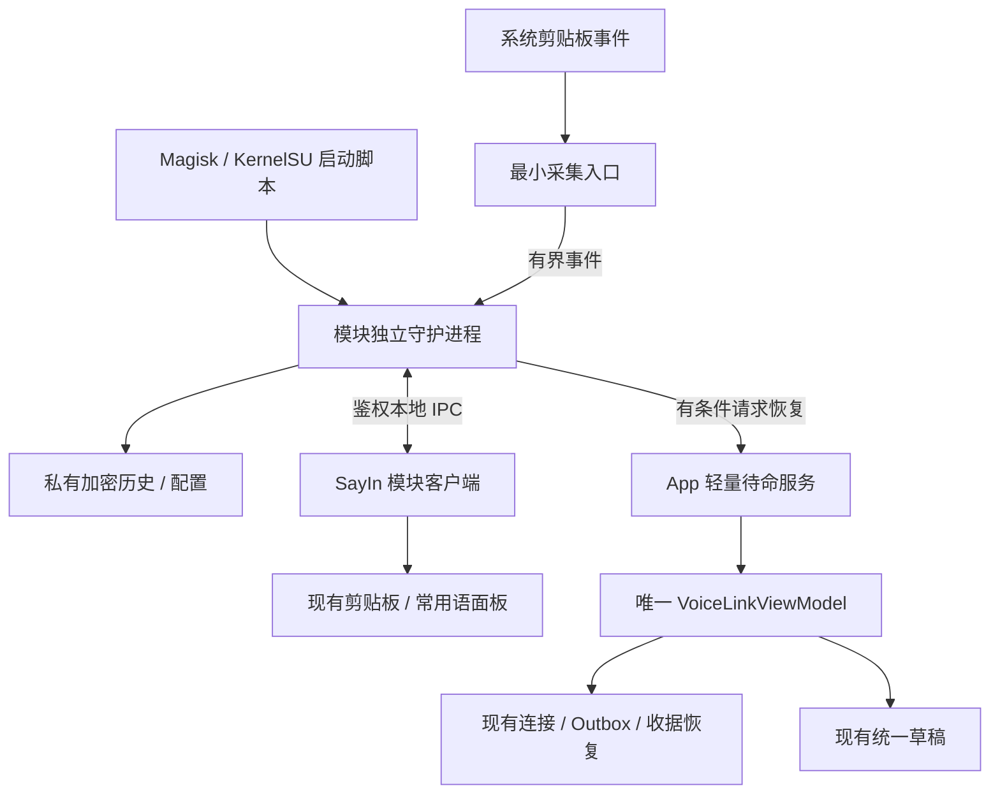

# 56 · SayIn Root 模块：剪贴板历史与应用保活

日期：2026-11-15。状态：**独立 C++ 剪贴板采集及加密历史已实施，见 60；App 读取和保活尚未实施，完整模块验收未完成**。

工程进展：已按 PathGuard-Next 的组织方式建立独立 [root-helper](../root-helper/README.md)，骨架历史见 [59](59-root-helper-engineering-foundation.md)。用户随后明确选择 C++，当前独立采集、Root 控制和加密历史的真机范围见 [60](60-root-helper-native-clipboard-collection.md)；原 Kotlin DEX 已移除。应用签名鉴权 IPC 和保活仍未实现，因此不能把阶段 A 整体记为通过。

本文件落实用户确认的两项能力：模块独立采集剪贴板，以及应用保活。非 Root 手机保持现有行为。源码调研依据见 [55](55-android-clipboard-projects-research.md)；[02](02-voicelink-root-assistant-plan.md) 是较早的快捷入口/工作会话方案，本次两项能力以本文为准，不要求用户额外开启限时工作会话。

补充调研见 [57 · SvcHub 进程监督](57-svchub-process-supervision-research.md)。借鉴其开机入口与独立进程监督思路，不引入 SvcHub 依赖或通用 Root WebUI。PID 探活不能代替 App 就绪握手；实施必须保留原子实例锁、真实进程身份、恢复预算和用户停止语义，不能照搬 PID 文件加无限周期拉起。该调研没有改变本文的职责边界，也不代表模块已完成验证。

## 1. 目标与最少必要职责

| 能力 | 用户需要的结果 | 实现责任 |
| --- | --- | --- |
| 剪贴板历史 | 在其它应用复制多段内容，稍后回 SayIn 可以选取 | 模块独立采集、过滤、持久保存；SayIn 显示并管理 |
| 应用保活 | SayIn 退到后台后尽量保持待命，被系统回收后可恢复 | 模块监督生命周期；App 提供轻量待命服务并恢复自己的状态 |

两项能力独立启停。剪贴板采集不需要 SayIn 保活；保活关闭不停止已单独启用的模块采集。App 不承担模块守护任务，避免两个进程互相拉起。

保活包含三个不同结果，分别报告：**进程已运行、待命服务已就绪、电脑连接已恢复**。仅存在一个 PID 不能显示全部正常；有网络连接也不能证明目标电脑正在允许接收。

模块不识别语音、不保持麦克风、不持有模型或配对令牌，也不创建第二份草稿、Outbox 或 WSS。保活不会自动录音、发送、释放 held、解除 uncertain 或改变电脑接收范围。

## 2. 当前代码与必须处理的根因

1. `QuickEntryService` 只为用户启用的悬浮入口运行；依赖悬浮窗权限，退出为 `START_NOT_STICKY`。不能为保活强制开启悬浮球或借用这个服务。
2. `RecordingService` 只在用户开始录音、系统接受 microphone 前台服务后工作。不能让它空转保活，更不能恢复进程后重新开麦。
3. `SayInApplication` 通过唯一 Application 级 `VoiceLinkViewModel` 共享草稿、识别和连接。待命服务应取得这个所有者，不能另建 Repository 或 SpeakSession。
4. `VoiceLinkViewModel.refreshConnection()` 当前仅在 Activity 可见或录音繁忙时请求连接。`VoiceLinkRepository.Event.Foreground(false)` 会取消网络监测并断开。**仅保住进程不会保住电脑连接。**
5. 草稿现为 150ms 合并落盘。进程突然被回收仍可能丢失最后尚未持久化的一小段编辑；模块不能把“能恢复进程”描述为“每个字均已同步保存”。

首版需将连接需求与界面可见性拆开，维持已有草稿恢复、Outbox 查询和发送授权边界，而不是把后台假装成前台。

## 3. 总体架构



只发布一个 SayIn 模块安装包。逻辑上包含一个最小平台采集入口和一个业务守护进程；采集入口不是第二套存储。守护进程承担历史唯一写入者和 App 生命周期监督，二者使用独立的任务与预算，数据库写入不得阻塞保活停止命令。

实现语言按用户最新选择采用 **C++20**：模块发布固定原生 ELF，由 Root 管理器启动，独立于 SayIn 和 ART。当前父进程唯一持有加密存储，子进程降为 shell UID 接入 Android 13 Binder；只通过继承的 socketpair 传递有界事件。模块启动/停止使用简短 shell 脚本。不保留 Kotlin/Rust 双实现。

原生独立进程不意味着自动获得剪贴板、Binder 或 SELinux 权限；实际调用身份和接口布局必须在目标 ROM 验证。进程创建、IPC、采集或后台服务恢复失败均按能力失败报告，不静默换成保活 App 的采集方案。

## 4. 模块结构与框架支持

```text
sayin-helper/
  module.prop
  customize.sh           安装检查，不自动启用采集
  service.sh             late_start 启动与有界监督
  action.sh              App 不可达时提供停止增强的后备入口
  uninstall.sh           停止、恢复自有策略、清理模块私有数据
  bin/sayin-helper       C++ 采集、历史和 Root 控制；保活尚未实现
  app-policy.json        固定包名、允许签名及 IPC 版本
  config/defaults.json   两能力默认关闭；已启用偏好由独立私有数据目录持有
```

业务数据与安装文件分离，更新模块不清空历史、启用偏好或用户停止标记。启动前取得实例锁；更新先停旧实例，收到退出确认后再启新实例，不能有两个历史写入者或两个 App 恢复监督者。框架不支持热更新就要求重启，不伪装为即时生效。

Magisk 和 KernelSU 使用各自明确支持的生命周期入口；不假设同一份启动脚本覆盖所有管理器行为。首批支持目标以真实手机的框架/ROM 为准，其余组合标为未验证。模块不修改 `/system`；不因使用 KernelSU 就额外要求 system 挂载的 metamodule。若选用 Zygisk，KernelSU 还需兼容的 Zygisk 实现，这与 metamodule 是两个问题。

不能只依赖管理器的 disable 标记或 uninstall 脚本就声称运行中任务已停止。守护进程应接收即时停止命令，检查模块停用/删除标记，并以低频、有界方式确认；停止后的采集入口必须快速丢弃事件。管理器停止到实际停采的时间需在验收中测量。

## 5. 剪贴板采集设计

### 5.1 采集入口选型与原型门槛

当前已选择并在单台 Redmi K40 / API 33 验证 **C++ 原生 Binder＋shell UID 监听**。只在回调后读取，不周期轮询正文；不设默认输入法，不依赖 SayIn 运行，不增加 Zygisk/Hook。对外声明的支持范围仅 API 33 arm64；其它平台拒绝安装/启动，不能拿 App 的 API 29 最低版本套给本模块。

初期 Zygisk 写入侧桥的设想暂不实施。只有当前监听路径在目标需求下无法满足且有证据时，再评估替换；不并存多种采集路线自动试错。

当前读取系统接受后的剪贴板快照，固定主用户 0、检查当前用户及解锁状态，解析敏感标记和系统时间戳，使用自身有序历史 ID 去重。回调不携带正文或真正逐次事件 ID，因此无法承诺极快覆盖不漏采，也无法精确还原写入 App。合并/丢弃计数是可观察到的下限，不能证明没计数就绝无遗漏；分类回调不重复插入同一时间戳。

Root 父进程不使用伪造包名直接读取。采集子进程以真实 shell UID 和 `com.android.shell` 调用；系统不允许时明确失败，不授予权限、不改 AppOps/SELinux/系统服务。Binder 事务码和 Parcel 布局来自固定 AOSP 13 源码，未知对象拒绝，不能将原生崩溃风险转移到 system_server。

### 5.2 事件与资源边界

- 只接收直接文本，不解析 URI、Intent、HTML 或读取 provider。首版限定手机主用户的默认设备剪贴板；其它资料/用户/虚拟设备拒绝采集。
- 敏感标记默认丢弃；未标记不代表内容不敏感。诊断只记录状态码、时间和丢弃计数，不记录正文。
- 初始建议 50 条、正文总量 512KiB、单条原始 UTF-8 16KiB，同时符合既有草稿文字规则。上限在实现前固定为测试常量；超限拒绝，不截断伪装完整文本。
- 事件队列建议 64 项且累计正文不超过 512KiB。满载时立即丢弃并增加计数，不阻塞系统线程，不无限分配内存；不通过轮询系统剪贴板补回缺失事件。
- 在同一个来源代次内按事件序号去重；重复分类通知不刷新历史。用户真正重新复制同文可移到最前。App 自己的「复制」也经过同一入口，不能手动插库再由监听插一遍。
- Hook 线程只做最少有界校验和非阻塞交接；文件、加密、IPC 等待、包信息查询均不在该线程做。平台桥内部队列同样有界，故障不能影响系统复制功能。

### 5.3 加密和单写者

模块拥有自己的 `/data/adb/sayin-helper` 私有目录，目录 0700、文件 0600，并验证实际 SELinux 可达性；不把明文历史写到共享存储，不让 App 直接读取 `/data/adb`。首期只有 Root 管理命令可读，普通 shell/App 被拒；App 接入必须另做 UID/签名鉴权。

存储基线为小规模有界 AES-GCM 加密快照，版本、存储身份与代次纳入 AAD；采用可验证的原子持久化及同步写入，错误时保留可诊断文件，不默默创建空库。清空/删除还须处理任何恢复副本，不能从旧备份恢复已删除内容。不复制 ClipHistory 的完整迁移框架。

模块必须独立恢复密钥，不能只依赖 App 进程中的内存密钥。原型基线可使用模块生成的随机 256-bit 数据密钥，保存在严格 root 私有权限的密钥文件；该方式**不是硬件 Keystore 保护**，不能抵御已读取模块目录或具有 root 的攻击者。若要求更强的离线密钥保护，应另行验证系统密钥方案，不能用“文件加密”声称密钥同目录泄露仍安全。

开机进入等待，首次用户解锁前不采集、不启动 SayIn。已解锁后的锁屏行为先沿用 55 的保守范围：锁屏期间暂停采集，解锁后恢复新事件，不补读暂停期间旧内容。密钥缺失/损坏或私有文件不可用时停止采集，不能降级明文；具体检测与恢复通过真机验证。

### 5.4 清除、暂停和 App 退出

清空先推进采集代次，使旧代次的读取、排队和迟到事件失效，再由唯一写入者完成持久清空；命令携带预期代次，返回实际提交结果。暂停、清空与更新采集入口使用同一屏障，不能让旧队列重新灌入。

清空模块历史不顺带清系统剪贴板。记录当前事件指纹防止重开面板复活旧内容；用户明确再次复制同文则可记录。此指纹也不能保存为明文正文。

关闭 SayIn 界面、回收或强行停止 App 均不自动关闭此前明确启用的独立采集。用户在设置关闭「剪贴板记录」或停用模块，才停止该能力。暂停不等于清除，停用不等于删除；清空历史仍需既有确认。

## 6. 应用保活设计

保活对象是**承载 SayIn 后台能力的进程**，不要求界面常开。首版复用当前主进程及唯一 Application 级业务所有者，不仅为隐藏界面就新增 `:runtime` 进程。

保活按三层配合：用户可开启的系统自启动/后台运行设置、App 的合法前台服务、Root 模块的异常退出监督。普通通知本身不构成保活；现有悬浮球背后的 `QuickEntryService` 已使用前台服务和通知，具备一定存活保障。悬浮窗不是必选条件，模块也不重复拉起已经健康运行的服务。

### 6.1 保持轻量待命

App 建立唯一的轻量待命服务所有权，优先复用已有前台服务的存活保障，不为悬浮球和模块各堆一套重复保活服务。实施时先评估将现有悬浮入口的服务所有权与悬浮 UI 解耦；只有职责确实需要时才增加 `RootStandbyService`，并明确服务之间的接续、通知去重与停止规则。不能通过空转 `RecordingService` 保活。

悬浮球只控制入口是否显示，后台待命不依赖悬浮窗权限。悬浮球关闭但后台保活仍开启时，轻量待命及对应前台通知可继续；两者都不需要且没有实际录音时，不留下空闲服务。模块恢复后台组件，不恢复 Activity。前台服务类型、声明理由和后台启动条件须按 targetSdk 37 实际能力验证。

只有系统接受服务进入合法前台状态、App 恢复已有数据且完成鉴权握手，模块才报告「待命就绪」。启动命令返回成功、PID 存在或 Binder 已连接都不足以证明恢复完成。该服务不能伪装成 microphone/media 服务；若后台恢复被拒绝，保活进入不可用状态，不弹界面或不断重试。

服务取得现有 Application 级 model：恢复草稿、历史与 Outbox，等待既有初始化结束。坏数据保持原存储阻断；不能为达到就绪状态清掉数据库。模块只接收就绪状态码，不接收业务正文或电脑凭据。

不默认预热 ASR/翻译模型，不持续持有 CPU/Wi-Fi 唤醒锁，不改全局 Doze、温控或所有 App 的 OOM 策略。仅在有实测必要时处理本 App 的电池豁免，记录原值与模块写入值；结束保活后按所有权恢复，用户本来设置的豁免不删除。

### 6.2 App 恢复判定

使用 Binder/IPC 断连和进程退出事件触发检查，不每秒 `pidof`。App 与模块建立带随机代次的单个待命租约，旧 PID、旧 Binder 和旧代次的迟到消息不能标记新实例就绪。IPC 暂时超时不等于进程死亡，不据此强杀 App。

| 事件 | 保活动作 | 剪贴板采集 |
| --- | --- | --- |
| 返回桌面、切换其它应用、关闭界面 | 保持轻量待命，不打开界面 | 已启用则继续 |
| 可确认的系统回收或崩溃 | 检查身份和停止标记后，有界恢复待命服务 | 独立继续 |
| 设置中强行停止、系统前台任务管理器「停止」 | 锁存暂停恢复，不清除停止状态、不拉起 App | 仍按独立采集开关运行 |
| 无法判定退出原因 | 保守暂停自动恢复，等待用户主动打开 | 不据此停止独立采集 |
| App 明确关闭保活 | 先持久化禁用，再停止租约和恢复任务 | 不改变采集开关 |
| 关闭采集 | 不改变保活开关 | 停止采集入口与任务 |
| App 卸载、签名不符或 UID 改变 | 停止恢复，不重新安装 App | 暂停采集和读取，保留加密数据待处理 |
| 停用/移除模块 | 停止保活、采集并恢复模块自有策略 | 停止 |

Android 13 的前台任务管理器停止整个 App 且不发送停止回调，不能只靠 `onDestroy()` 识别。结合 package stopped 标记、可用的退出原因及明确关闭命令；`REASON_USER_REQUESTED` 在不同系统可能含最近任务划走、更新等含义，不对 description 字符串做“全 ROM 精确识别”的承诺。更新走单独的包替换流程；信息不足时不自动拉起。

用户主动再次打开可信 SayIn，可在可见交互中重新建立待命租约并解除本次恢复抑制，不额外弹确认；不能由模块启动的服务假冒这次用户打开。主动开关被关闭时，仅打开 App 不自行重新启用。

### 6.3 恢复预算和跨重启

初始建议：每次确认异常退出后按 1/5/15 秒退避，10 分钟内最多 3 次恢复尝试；每次等待服务就绪最多 10 秒。超预算进入暂停，用户主动打开后才重置。持续稳定运行后可重置短期故障计数，规则用单调时间和启动代次验证，不能靠调整墙钟解除预算。

模块守护进程自身也由一个启动监督者有界重启；App 不反向重启模块。若守护反复崩溃，停止本轮启动并输出无正文的故障状态，不能由脚本无限快速循环。

两项已明确启用的偏好可以持久保存，不引入每 30 分钟重新开启工作模式的负担。设计目标是设备重启并首次解锁后恢复已启用能力；恢复前检查模块状态、App 身份、密钥、用户停止锁存及故障预算。重启不能抹掉此前的用户停止标记；未验证该路径的框架不宣称支持开机保活。

### 6.4 保活后的连接与自动发送必须分离

现有 `repository.foreground(Boolean)` 实际控制连接需求，实施时应按职责重命名/重构，不追加一个“假前台”特殊分支。连接需求来自：有可见输入界面、用户已开始的录音仍在进行，或系统接受且授权有效的 Root 待命服务。

```text
需要连接 = 可见输入界面 OR 正在进行的用户录音 OR 有效 Root 待命
本次自动发送授权 = 既有可见性、草稿修订、连接代次和 ReceptionScope 共同校验
```

连接需求不授予发送权。界面离开后仍撤销原自动发送/结束并发送票据；后台待命、模块重启和再次打开都不得复活它们。

复用已有固定证书、认证、网络变化监测和有界发现退避。局域网权限撤销、网络不可达或电脑离线只改变连接状态，不触发杀进程/重启 App；不在后台弹授权窗口，也不做全网扫描或常驻无界发现。

恢复连接仍先查询旧请求，不自动重新 submit、上传或 release；主动暂停、存储阻断、uncertain 均保持。后台保活不承诺 Wi-Fi/Doze 下永不掉线，必须测量恢复时间和功耗。桌面端无需新增模块身份、端口或绕过接收安全的接口。

### 6.5 主动引导开启系统自启动

用户开启后台保活时，可以主动提示允许 SayIn 自启动；已有悬浮入口恢复失败时，也可提供同一设置指引。自启动有助于部分厂商系统允许开机/后台启动，不等于进程永久存活、不代替前台服务，也不解除强行停止、录音权限或 targetSdk 37 的后台启动限制。

引导只展示一个简短建议和一个主操作，例如「允许自启动，可帮助 SayIn 在后台恢复运行」，按钮为「前往设置」，另有「暂不」。放在首次启用的页面内或首次启用流程的一次提示中，不在每次启动、打开面板或断线时弹窗；不阻断录音、发送、配对或普通单条剪贴板功能。

从厂商自启动设置返回不等于设置成功：

- Android 没有统一的厂商自启动状态查询接口。仅对已验证的 ROM/版本读取可靠状态；其余显示「请在系统中确认」，不以打开过设置页、`RESULT_OK` 或用户点过按钮伪造「已开启」。
- `ActivityManager.isBackgroundRestricted` 只能表示平台后台限制，电池优化豁免也只是另一项状态；两者均不能推断厂商自启动已开启。
- 优先使用已验证的厂商设置入口，启动前检查可处理并捕获拒绝/组件变更。不可用时回退 `ACTION_APPLICATION_DETAILS_SETTINGS` 的本应用详情页，并给出适合当前系统的手动路径；详情页也不可打开时只保留文字指引，不崩溃、不遍历猜测私有组件。
- 自启动、后台电池限制、通知许可各自处理，只在确实相关时提示。不给用户一次堆出多项必做授权；不默认要求锁定最近任务、开启悬浮窗或给予全部权限。

用户选择「暂不」后，自动提示在本安装内保持抑制；后台设置页面仍保留手动入口。仅在真实检测到新的相关受限状态或可解释的恢复失败时，显示一次非阻断修复建议；普通网络断开不能推断自启动被禁用。不因状态未知循环催促，不从后台直接打开系统设置。

这是 App 的设置辅助，不需要 Root，也不要求模块直接修改厂商自启动数据库。非 Root 用户可在主动使用现有后台入口时获得指引，但不因此新增后台服务、开机接收器、剪贴板历史或额外权限。当前 Manifest 未声明 `RECEIVE_BOOT_COMPLETED`；若未来要增加普通 App 开机行为，必须另行明确需求并验证，不能把本次设置指引描述为已支持开机启动。

## 7. 本地 IPC 与文件读取

首个原型优先评估 Android 本地 socket，使用内核对端凭据校验真实 UID/PID，再绑定安装包 `seeyuer.sayin`、主用户及固定允许签名。abstract socket 不能依靠名称保密作为鉴权；SELinux 是否允许双方连接独立验证。可行性不满足时再选择 Binder，不同时实现两套通道。

模块产物固定允许的 App 签名摘要；开发构建仅允许显式测试签名和隔离包。不能首次连接就相信客户端自己报告的包名/证书。卸载、换签名或 UID 重用使授权与旧连接失效，历史不暴露给后来同名 App。

IPC 分开区分系统采集入口与 App 控制入口；普通 App 不可提交伪造采集事件，系统事件来源身份也不能替代源 user/profile 过滤。只开放固定操作，不接受任意命令、路径、PID、包名或 URL。

| 操作 | 用途 |
| --- | --- |
| `get_status` | 能力、启用状态、待命/连接分项状态、故障码、丢弃计数 |
| `set_clipboard_enabled` / `set_keepalive_enabled` | 分别启停能力，持久确认后返回 |
| `list_clips` / `get_clip` | 有界分页预览和按 ID 获取正文 |
| `delete_clip` / `clear_clips` | 单条删除/清空，校验历史与采集代次 |
| `attach_standby` / `report_ready` / `detach_standby` | 待命服务握手和代次绑定 |
| `stop_all` | 高优先级停止两项能力，供 App 和模块后备入口使用 |

建议每连接帧上限 128KiB、分页 20 条预览、最多 4 个 App 连接、请求超时 3 秒；具体常量在原型中收敛并测试。预览不批量返回完整正文。清空等变更超时只表示结果未确认，使用原请求 ID 查询结果，不能因 UI 重试执行新的变更。

历史可保存在文件，但不把文件本身作为任意 App 可访问的接口。App 通过 IPC 取数据，不直接读写模块库；首次不额外维护一个会独立更新的 App 历史副本。页面缓存绑定存储身份与修订，清空成功、授权变化或断连后旧缓存不能覆盖新状态。

## 8. 设置与日常交互

设置新增一个「Root 增强」页面，提供两个有明确作用的开关：

| 控件 | 作用 |
| --- | --- |
| 剪贴板记录 | App 不运行时，也由模块记录可采集的文字 |
| 后台保活 | 保持 App 轻量待命，并恢复可确认的异常退出 |

初次安装均关闭。首次开启采集说明范围、存储与独立停止方式；保活说明退出界面与系统强行停止的区别。之后正常启用不重复弹确认，不再给用户选择 Hook、UID、存储路径或网卡。

一个状态区显示实际结果，例如「模块运行中」「采集中 · 待命就绪」「连接未恢复」「保活已暂停：系统停止」「采集不可用：系统接口不支持」。避免把两个能力压成一个模糊“已连接”。主说话页不常驻显示技术状态或新增 Root 操作按钮。

自启动指引位于后台运行相关设置，不作为第三个功能开关。它跳转到系统开关，不在 SayIn 内保存一份冒充系统真实状态的布尔值；只保存提示是否已展示/暂不等 UI 偏好。

模块未装/未启用、无 Root 的手机继续当前单条剪贴板及既有生命周期，不增加历史或后台权限。模块历史可用时，同一个剪贴板标签显示多条；点条目粘贴并关闭，菜单复制/粘贴保留面板。常用语独立不变，任何采集都不自动发送。

模块不可用时明确提示并允许查看当前剪贴板，不假装旧模块缓存仍是最新历史；不能在 App 内静默安装/升级模块。原始模块数据保留，不把临时断连当成用户清空。

## 9. 实施阶段与验收门槛

| 阶段 | 实际工作 | 必须通过后才能继续 |
| --- | --- | --- |
| A：最小能力原型 | 实际 ROM/Root 清单；独立采集；鉴权 IPC；固定组件的后台待命恢复 | App 不运行时复制仍能记录；未知客户端被拒；不出现 Activity；强停不被反复恢复 |
| B：模块历史 | 唯一写入、加密、界限、去重、清空屏障、升级/停用 | 快速复制与积压计数、敏感过滤、故障写入、迟到事件、密钥损坏、清空后不复活 |
| C：App 保活 | 轻量服务、停止识别、预算、连接需求拆分、跨重启 | 可确认异常可恢复；主动停止和原因未知不拉起；恢复不录音、不发旧请求 |
| D：组合面板与普通回归 | Root 多条列表、管理、完整页/快捷卡、非 Root 现状 | 两开关独立；现有插入/撤销/翻译/发送与配对回归通过 |
| E：资源与支持范围 | 熄屏/娱乐/锁屏时段、不同系统组合、故障恢复 | 公布实测矩阵、CPU/RSS/能耗/延迟/丢弃，停用和升级无残留运行实例 |

每个实施阶段依项目规则完成本阶段及相关回归后，再提交和推送。实现验证使用隔离包、独立模块数据目录、明确测试签名和临时电脑身份/端口，不影响日常配对和系统剪贴板隐私。测试只生成无敏感样例，不采集用户现有历史作为测试数据。

修改前先记录普通模式基线与后台断连行为。涉及 App 接入时执行项目 Android JVM、构建、Lint、i18n；涉及共享接收/网络行为时执行桌面完整测试、Clippy、包限定格式和依赖检查。独立 C++ 模块自身执行 CMake/CTest、原生构建、打包验证、IPC/存储故障测试与真实 Root 设备回归，不能只用 App 构建或模拟回调代替。当前限定范围和实际测试见 60。

保活测试包含：关闭界面、划走最近任务、可确认回收/崩溃、设置强停、Android 前台任务管理器停止、更新、卸载重装、UID/签名变化、设备重启未解锁/已解锁、模块停用、反复崩溃和旧实例迟到握手。

设置引导测试包含：厂商入口可用/失效、拒绝启动及应用详情回退；开启、拒绝、状态未知和返回未修改；「暂不」后不重复弹出；通知拒绝与自启动状态不互相冒充；非 Root 无额外服务或权限；悬浮球开关与待命接续不产生双服务、双通知或误停止。

链路回归包含：草稿持久恢复和损坏、旧请求先查、重连不重放、暂停/held/uncertain、自动发送票据失效、权限撤销、断网不重启进程、电脑离线、多网卡及已有有界发现。记录 150ms 草稿落盘窗口的真实损失边界，不承诺本设计消除了它。

资源比较至少包括普通模式、仅采集、仅保活和两者开启四组；同机同网络进行 30/60 分钟及多轮长时对照。报告原始次数、成功/失败/超时、恢复耗时分位数、CPU/RSS/唤醒和能耗；没有基线不预填“零耗电”“永不被杀”或提升比例。

## 10. 本次核对与未验证项

本文件最初为设计阶段记录。后续骨架安装见 59、C++ 独立采集实施及真实验证见 60；没有实现 App 待命服务或进行保活/功耗验收，也不复用 55 中第三方 JVM 成绩作为本模块的通过证据。

仍需原型解决的关键事项：可靠的实际剪贴板更新入口及其依赖许可；目标 ROM 的后台待命服务启动条件；停止原因与系统更新的可区分性；本地 IPC/SELinux；密钥及用户解锁检测；管理器停用与更新时旧实例的停止。这些是实施门槛，不影响用户已确认的职责边界。

官方资料核对日期为 2026-11-15：

- [Magisk Developer Guides](https://topjohnwu.github.io/Magisk/guides.html)：late_start 启动、模块脚本和启停标记。
- [KernelSU Module guide](https://kernelsu.org/guide/module.html)及[官方源码](https://github.com/tiann/KernelSU/blob/main/website/docs/guide/module.md)：启动/停用、system 挂载与 metamodule 的关系。网页本次返回 403，改核对官方仓库文档，未把网页失败视为资料已读。
- [KernelSU App Profile](https://kernelsu.org/guide/app-profile.html)：UID、capabilities 和 SELinux 与普通 App 权限的区别。
- [Android：处理用户停止前台服务应用](https://developer.android.com/develop/background-work/services/fgs/handle-user-stopping)：整个 App 停止且不发送回调。
- [Android：前台服务后台启动限制](https://developer.android.com/develop/background-work/services/fgs/restrictions-bg-start)、[服务类型](https://developer.android.com/develop/background-work/services/fgs/service-types)。
- [ApplicationExitInfo](https://developer.android.com/reference/android/app/ApplicationExitInfo)：退出原因及版本语义，不能作为跨 ROM 无歧义的唯一停止判据。
- [Android Settings](https://developer.android.com/reference/android/provider/Settings)、[ActivityManager.isBackgroundRestricted](https://developer.android.com/reference/android/app/ActivityManager#isBackgroundRestricted())：系统设置入口与平台后台限制状态；不把这些 API 当作厂商自启动授权查询。

官方机制不等于本模块已经可用；支持范围以实施后的真实设备记录为准。
