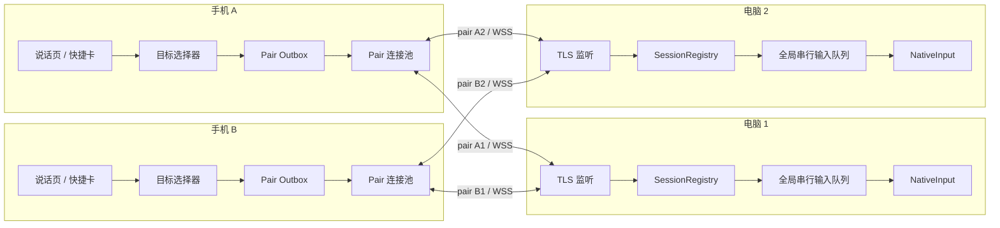

# SayIn 多手机 / 多电脑（多对多）设计方案

更新：2026-11-25  
状态：设计稿，尚未实现。  
目标协议：`sayin.v3`。  
适用范围：Android 10+ 原生 App ↔ Windows 原生接收端，同一可信局域网 IPv4。  

本方案基于当前 v2 实现，但**不以兼容 v2 为约束**；`voicelink` 只作为历史协议名保留在迁移记录中。升级通过一次性数据迁移和升级前后测试保证既有草稿、Outbox、历史与回执不丢失；协议、发现和 TLS 标识改名导致的重新配对必须在 UI 中明确说明。  

---

## 0. 结论

采用：

> **本地优先的二部图：每台手机可配对多台电脑，每台电脑可接收多台已授权手机；每对手机—电脑是独立信任单元和独立 WSS 会话；发送必须指定目标电脑；电脑侧所有输入共用一个串行执行器。**

### 0.1 协议命名

本项目对外协议统一命名为 **SayIn**，不再使用 VoiceLink / `voicelink` 作为新协议名。

| 项目 | v3 命名 |
| --- | --- |
| 协议族 | `sayin` |
| 版本标识 | `sayin.v3` |
| WebSocket 路径 | `wss://<tls_name>:<port>/sayin/v3` |
| 发现服务类型 | `_sayin._tcp.local` |
| 发现实例 | `SayIn-<host_id>` |
| TLS 名称 / SAN | `sayin-<host_id>.local` |
| 配对 CPace 帧 | `SAYIN3`（后跟 LF） |
| JSON 版本字段 | `v: 3`（字段名不变） |

`voicelink.v2` 仅作为历史协议名出现在迁移测试、旧文档引用和升级说明中。新代码、日志、错误、资源名、发现记录和新文档不得再用 `voicelink` 命名协议。

证书 SAN、发现服务名和 CPace 帧都属于协议可观察标识，改名会使旧 v2 客户端无法按原名称连接。开发期接受这一次破坏性变更；升级测试必须覆盖“旧配对需要重新配对”的明确提示，不能静默接受旧证书或旧服务名。

不做：

- 中心服务器 / 云端中继；
- 一条消息默认广播到所有电脑；
- 多台手机同时操作焦点；
- 全局共享 token；
- 一台电脑多个主机身份；
- 单条 socket 上复用多个主机的复杂协议。

“任意个”是产品语义；实现必须有有界配额和连接池，不能承诺无限设备。

---

## 1. 第一性原理

### 1.1 不可再还原的事实

1. **一次输入是一个不可分割的请求。**  
   文本、Enter、图片都必须属于一个请求、一个目标、一个来源设备，并产生独立结果。

2. **一台电脑只有一个当前输入目标。**  
   目标应用/窗口由电脑本地的前台与接收范围决定，不能由手机指定为任意窗口句柄。

3. **电脑的系统输入必须串行。**  
   两台手机同时向同一前台窗口输入，会交错字符或快捷键；协议层不能宣称并发安全。

4. **信任是成对的，不是全局的。**  
   手机 A 信任电脑 1，不代表信任电脑 2；电脑 1 信任手机 A，不代表信任手机 B。

5. **网络地址不是身份。**  
   mDNS、IP、端口、host 名称都只是候选路由；只有固定证书和配对 token 才能建立信任。

6. **每台手机、每台电脑都是独立故障域。**  
   电脑 2 断网不能让电脑 1 的请求失败；手机 A 的 Outbox 不能阻塞手机 B。

7. **请求结果必须与来源配对绑定。**  
   电脑 1 的 `accepted/injected/uncertain` 不能显示成电脑 2 的结果。

### 1.2 术语

| 术语 | 定义 |
| --- | --- |
| Host | 一台安装了 SayIn 接收端的电脑，拥有稳定 `host_id`、私钥和叶证书 |
| Phone installation | 一台手机上的 SayIn 安装；不作为跨电脑的全局身份 |
| Pair | 一台手机与一台电脑之间的授权关系；拥有 `pair_id`、电脑签发的 `device_id` 和独立 token |
| Session | 一条已认证的 WSS 连接；属于且仅属于一个 pair |
| Request | 一次不可变输入意图；属于一个 pair，拥有请求 UUID |
| Receipt | 请求在电脑端的结果；属于原 pair，不可跨 pair 查询 |
| Target | 电脑本地签发的输入激活范围；不是手机侧选择的应用窗口 |
| Global input executor | 电脑端唯一的串行输入执行器，对全部手机共用 |

---

## 2. 范围

### 2.1 必须支持

- 一台手机配对并连接多台电脑；
- 一台电脑接收多台已授权手机；
- 任意手机向任意已配对电脑发送，前提是用户选择该目标；
- 多台手机同时在线；
- 每对手机—电脑独立重连、独立暂停状态、独立回执；
- 配对、撤销、重配互不影响其他 pair；
- 文本、Enter、图片、查询、回执、历史、Outbox 全部按 pair 隔离；
- 电脑全局暂停、全局 `uncertain` 阻断；
- 升级前后既有数据与功能回归。

### 2.2 明确不做

- 自动广播到所有已配对电脑；
- 多台电脑协同输入同一个目标；
- 跨电脑的全局请求去重或全局顺序；
- 云端账号、公网穿透、中心 relay；
- 手机指定电脑的任意窗口句柄；
- 一台电脑多个 host 身份；
- 每台手机无限配对/无限连接。

### 2.3 单条消息的目标语义

```text
一条消息 = 一个手机 + 一个目标电脑 + 一个请求 UUID
```

用户要发到第二台电脑，必须显式选择第二台电脑，生成第二个请求。  
不把“发送成功”显示成所有电脑都成功。

---

## 3. 总体架构



### 3.1 为什么每条 pair 一条 WSS

- 复用现有 TLS、固定证书、token、回执、图片绑定；
- 一个 pair 的故障不影响其他 pair；
- 不需要可信中心；
- 不需要在一条 socket 上实现主机多路复用；
- 协议和测试都能按 pair 独立推理。

手机不必永久保持 N×M 条连接：

- 当前默认目标保持连接；
- 其他目标按需连接；
- 空闲断开；
- 每台电脑独立退避。

---

## 4. 身份与配对

### 4.1 身份

```text
Host:
  host_id        电脑安装唯一，稳定
  host_key       仅电脑持有
  host_cert      每台电脑独立自签叶证书
  tls_name       sayin-<host_id>.local

手机:
  installation   本机本地概念，仅用于本地 UI/诊断
  pair.device_id 电脑为该 pair 签发的授权 ID，不跨电脑复用
  pair.pair_id   电脑签发的随机 UUID
  pair.token     电脑签发的 256 位 bearer token
```

关键决定：

- 手机没有跨电脑共享的认证 `device_id`；
- 每台电脑签发自己的 `device_id`，避免跨主机关联；
- `pair_id` 是授权单元，不是设备全局 ID；
- 重配生成新 `pair_id` 和新 token，旧 pair 立即失效；
- `pair_id` 不进入发现广播，不作为秘密，但必须参与消息作用域。

### 4.2 配对流程

```text
电脑生成配对窗口
  → 手机扫码 / 输入地址+短码
  → CPace / TLS 验证
  → 电脑人工批准
  → 电脑创建 pair：
        pair_id = 随机 UUID
        device_id = 随机 UUID
        token = 256-bit 随机值
  → 手机保存 host profile + pair + 加密 token
```

多对多下的变化：

- 一台电脑可同时存在多个待批准请求；
- 每次批准只创建一个 pair；
- 手机可对其他电脑重复配对；
- 电脑的证书/主机身份不因新增手机而改变；
- 手机新增电脑不改变已有 pair 的 token；
- 配对批准 UI 必须显示设备名和来源地址，不能只显示同名。

### 4.3 撤销

- 撤销某个 pair：关闭该 pair 的所有 session，删除 token，取消未开始请求；
- 不删除其他 pair；
- 不删除电脑历史其他来源记录；
- 手机删除某台电脑只删除该 host 下 pair；
- 旧 token 立即不可用于新 hello。

---

## 5. 连接与会话

### 5.1 手机侧连接池

```text
HostConnectionState:
  Disconnected
  Connecting
  Ready
  Reconnecting
  AuthExpired
  Revoked
```

规则：

- 每个 pair 最多一个当前连接；
- 新连接成功时，旧连接由客户端主动关闭；
- 默认目标可常驻；
- 最多保持 2～3 条活跃连接；其他按需；
- 断线只影响该 pair；
- 切换目标不迁移正在发送的请求；
- 发送前确保目标连接 Ready；
- 无连接时保留 Outbox，不静默换目标。

### 5.2 电脑侧 SessionRegistry

```text
Session {
  session_id
  pair_id
  device_id
  token_hmac
  socket
  last_seen
  state
}
```

规则：

- 电脑可同时存在多个不同 pair 的 session；
- 同一个 pair 新 hello 成功后，旧 session 被 fencing；
- 不同 pair 之间不互相 fencing；
- 所有 session 可接收状态、查询和回执；
- 只有通过当前有效 pair 认证的 session 能提交新请求；
- 电脑重启后全部 session 重新认证。

### 5.3 取消“活动发送设备”

删除：

- `active_device_id`；
- `NOT_ACTIVE_DEVICE`；
- “仅一台手机能发送”的切换逻辑。

替换为：

- 所有已认证 pair 都可提交；
- 全局输入仍串行；
- 电脑 UI 只展示来源设备，不要求用户选择“当前手机”。

---

## 6. 路由、顺序与队列

### 6.1 请求作用域

每个请求必须持久化：

```text
pair_id
host_id
device_id
request_id
target
op
```

唯一键：

```text
(pair_id, request_id)
```

`device_id` 用于审计和显示，但授权判定以 `pair_id + token` 为准。

### 6.2 手机发送路由

```text
用户选择电脑 X
  → 取得 pair X
  → 冻结 target 和 pair
  → 写入 Outbox(pair_id, request_id)
  → 连接 pool[X]
  → submit
```

禁止：

- 发送失败后自动改投另一台电脑；
- 把电脑 A 的 pending 请求改成电脑 B；
- 把电脑 A 的回执套到电脑 B 的请求上；
- 用同一个 request_id 在多个 pair 上复用并期待一次结果。

### 6.3 电脑接收顺序

所有 pair 的已接受请求进入一个全局串行执行器：

```text
Phone A req-1 ─┐
Phone B req-1 ─┼→ global queue → single input executor → foreground
Phone C req-2 ─┘
```

建议默认：

- 全局 FIFO；
- 每个 pair 有未完成请求上限；
- 全局有总上限；
- 单条请求不可长时间阻塞控制/查询通道；
- 控制、状态、查询不由输入执行器阻塞；
- 不允许两台手机同时执行输入。

公平性：

- 首期用“每 pair 配额 + 全局 FIFO”即可；
- 若实测出现单设备长期占满，再加入按 pair 的轮转；这需要基准数据，不预先增加调度实体。

### 6.4 `uncertain` 与全局阻断

任何请求进入 `uncertain`，表示电脑可能已经部分输入，系统无法确认：

- **全局输入闸门关闭**；
- 所有手机收到 `blocked`/`uncertain` 状态；
- 不允许其他手机继续输入，避免在未知输入状态上继续写；
- 用户在电脑端核对后才解除；
- 只影响执行，不删除其他 pair 的草稿或 Outbox。

这是多设备下必须保留的安全边界。

### 6.5 暂停

建议首期只有**电脑全局暂停**：

- 关闭所有新输入执行；
- 允许连接、查询、状态、回执；
- 不自动恢复，不越过后来的暂停；
- 手机显示“电脑已暂停”，不自动切换目标。

暂不做单设备暂停；需要阻止某台手机时，使用“断开该设备”或撤销 pair。  
这样可以避免暂停代次、设备级状态和 UI 的多套语义。

---

## 7. 协议 v3

### 7.1 版本

- 新协议为 `sayin.v3`，JSON 版本字段仍为 `v:3`；
- 不接受 v2 自动降级；
- 双方必须同时升级；
- 旧 v2 客户端收到明确错误，提示升级；
- 不做双协议长期维护。

### 7.2 配对

```json
{"v":3,"t":"pair","name":"Redmi K40","window_id":"...","secret":"..."}
{"v":3,"t":"paired","host_id":"...","pair_id":"...","device_id":"...","token":"..."}
```

### 7.3 认证

```json
{"v":3,"t":"hello","pair_id":"...","device_id":"...","token":"...","name":"Redmi K40"}
{"v":3,"t":"welcome","session_id":"...","host_id":"...","pair_id":"...","device_id":"...","state_rev":"7","paused":false,"target":"...","capabilities":["text","key_enter","control","query","image"],"limits":{...}}
```

`welcome` 不再有 `active_device_id`。

### 7.4 提交与回执

```json
{"v":3,"t":"submit","session_id":"...","id":"...","op":{"kind":"text","text":"..."},"target":"..."}
{"v":3,"t":"status","session_id":"...","id":"...","order":"42","st":"accepted"}
```

所有消息的 `session_id` 隐式绑定 pair；服务端仍要核对 session 的 pair 与请求 pair 一致。

### 7.5 状态

```json
{"v":3,"t":"state","state_rev":"8","paused":false,"target":"...","blocked":false,"blocked_reason":null}
```

删除 `active_device_id`。  
可选增加 `sources` 摘要，但不得把其他设备的正文或私有元数据广播给手机。

### 7.6 错误

删除：

- `NOT_ACTIVE_DEVICE`。

新增/保留：

- `PAIR_REVOKED`
- `PAIR_MISMATCH`
- `GLOBAL_PAUSED`
- `BLOCKED_REVIEW`
- `QUEUE_FULL`
- `RATE_LIMITED`
- `STALE_SESSION`
- `ID_CONFLICT`
- `STORAGE_UNAVAILABLE`

### 7.7 图片

- `image_hello` 增加 `pair_id`；
- 图片资源、上传 ID、binding、submit 全部按 pair 校验；
- 一个 pair 的资源不能被另一个 pair 使用；
- 每 pair 图片并发和全局图片并发分开限制。

---

## 8. 数据模型

### 8.1 手机

```text
hosts
  host_id PK
  display_name
  tls_name
  cert_der
  cert_sha256
  last_endpoint
  last_seen

pairs
  pair_id PK
  host_id FK
  device_id
  token_ciphertext
  token_nonce
  device_name
  scopes
  created_at
  revoked_at
  last_used_at

outbox
  pair_id
  request_id
  payload
  state
  created_at
  PRIMARY KEY(pair_id, request_id)

history
  pair_id
  device_id
  request_id
  ...
```

规则：

- `host_id` 下最多一个有效 pair（重配替换旧 pair）；
- `pair_id` 不复用；
- 默认目标只是 `pairs` 上的 UI 偏好，不是安全字段；
- 草稿不绑定 pair；发送时冻结目标；
- 已冻结请求不能改 pair。

### 8.2 电脑

```text
host_identity
  host_id
  key_protected
  cert_der

devices
  device_id PK
  pair_id UNIQUE
  token_hmac
  name
  state
  created_at
  last_seen
  revoked_at

receipts
  pair_id
  device_id
  request_id
  accepted_order
  state
  payload
  UNIQUE(pair_id, request_id)

input_queue
  accepted_order PK
  pair_id
  device_id
  request_id
  state

image_resources
  pair_id
  device_id
  resource_id
  ...
```

规则：

- `accepted_order` 全局单调；
- 查询只返回当前 session 所属 pair 的请求；
- 图片资源按 pair/device 归属；
- 撤销 pair 不删除历史，但阻止新请求。

---

### 8.3 命名变更与升级

v3 同时把协议名称、发现服务类型、TLS 名称和 CPace 帧改为 SayIn 命名。由于旧 v2 客户端固定使用 `voicelink` 服务名、`vl-` TLS 名称和旧帧，升级后旧手机无法继续按原发现记录连接。

这是开发期的明确破坏性变更，不引入双协议兼容。升级测试必须验证：

- 旧配对记录仍可读，但连接时提示“协议已升级，需要重新配对”；
- 不会静默接受旧 `voicelink` 服务或旧证书；
- 用户明确重新配对后，旧草稿、历史、Outbox 仍保留；
- 若产品决定保留旧 TLS 证书以省去重配，必须单独设计并测试，不能在本方案中隐含保留。

## 9. UI

### 9.1 手机

说话页/快捷卡：

```text
发送到：客厅电脑  ⌄
```

- 默认最近使用/用户固定目标；
- 点击打开电脑列表；
- 目标离线时保留草稿，禁止自动改发；
- 录音开始后切换目标：取消自动发送倒计时和当前发送票据；
- 自动发送绑定录音开始时的 pair；不自动跨电脑。

设置页：

```text
电脑
  客厅电脑      已连接
  书房电脑      已配对 · 离线
  + 添加电脑
```

每台电脑可重命名、忘记、更新地址；不显示内部 IP 作为主标题。

### 9.2 电脑

设备区域：

```text
已授权设备
  Pixel 8        在线
  Xiaomi 14      已暂停/离线
  待批准请求     2
```

- 每条输入显示来源设备；
- 全局暂停按钮；
- 逐设备断开/撤销；
- 不再有“当前活动手机”选择；
- 队列中显示顺序和来源，避免误以为多手机并发输入。

### 9.3 自动发送

- 票据包含 `pair_id`、`request_id`、`target`；
- 目标切换、电脑暂停、pair 撤销、网络代次变化都使票据失效；
- 电脑 1 的自动发送票据不能用于电脑 2；
- 不把“所有电脑已发送”显示成一次成功。

---

## 10. 安全

- 每台电脑独立叶证书，手机独立固定；
- 每对 pair 独立 token，电脑只存 HMAC；
- 手机无跨电脑认证 ID；
- `pair_id` 参与归属校验，但不单独作为认证；
- 发现只更新候选地址，不更新证书/身份；
- 多台手机待批准时，批准界面显示设备名和来源；
- 每 pair 限速；全局限速/队列独立；
- 一个 pair 不能查询/复用另一个 pair 的 request、receipt、image；
- 撤销立即 fencing，只影响该 pair；
- 旧 v2 客户端不能降级连接；
- 任何 `uncertain` 全局阻断输入。

---

## 11. 故障与恢复

| 场景 | 行为 |
| --- | --- |
| 电脑 1 离线 | 仅 pair A1 重连；A2/B1 不受影响；保留 A1 Outbox |
| 手机 A 离线 | 电脑 1 其他 session 继续；A 的请求保持原状态 |
| 同 pair 重连 | 新 session fencing 旧 session；先 query 旧请求，不自动重发 |
| 不同 pair 重连 | 互不 fencing |
| 电脑重启 | 所有 session 重认证；已接受请求从账本恢复；不重复输入 |
| 手机切换目标 | 新请求去新 pair；旧 pending 不迁移 |
| 电脑全局暂停 | 所有 pair 停止新输入；连接/查询保留 |
| 单 pair 撤销 | 关闭该 pair；其他 pair 正常 |
| `uncertain` | 全局输入阻断，等待电脑核对 |
| 发现到多台电脑 | 候选列表；只有已知 host 的证书可用于认证 |

---

## 12. 图片输入

- 图片是 pair 作用域资源；
- 上传连接必须绑定 `session_id + pair_id`；
- `image_begin`/块/`image_finish` 必须匹配同一 pair；
- 资源不可跨 pair 复用；
- 电脑图片配额按 pair 和全局分别计算；
- 手机图片草稿冻结目标 pair；
- 电脑 1 的图片资源不能提交到电脑 2；
- 图片取消只回收该 pair 的上传。

---

## 13. 发现

- 每台电脑发布自己的 `_sayin._tcp.local`，TXT 带 `v=3`、`host_id`、实际 IPv4；
- 手机可发现多台电脑；
- 发现只用于地址候选；
- 手机只对已保存 host_id 的证书做认证；
- 新电脑必须重新配对，不能仅凭发现信息接入；
- 一台电脑的证书变化要求重新配对，不自动替换；
- 电脑新增手机不改变其发现记录。

---

## 14. 容量与性能

产品语义“任意个”，工程上有界：

| 限制 | 初始建议 |
| --- | --- |
| 每手机有效电脑 | 8 |
| 每手机活跃连接 | 2～3 |
| 每电脑授权手机 | 16 |
| 每 pair 未完成请求 | 8 |
| 全局未完成请求 | 32 |
| 每 pair 提交速率 | 沿用 20/s 令牌桶 |
| 全局提交速率 | 独立总桶 |
| 图片并发 | 每 pair 1，全局 2 |

所有限制写入 `welcome.limits`，手机不猜测。

---

## 15. 分阶段实施

每一阶段都必须实现、测试、提交，不允许留下“以后再说”的断点。

### 阶段 0：基线与测试夹具

交付：

- 记录当前 1:1 行为的自动化基线；
- 手机旧数据库、电脑旧账本 fixture；
- 双端协议向量快照；
- 多客户端测试工具（多个独立 device/host 身份）。

退出条件：

- 现有 1:1 测试全部通过；
- 能重复生成两个手机客户端、两个电脑接收端；
- 所有测试使用独立数据目录，不碰日常配对。

### 阶段 1：领域模型与 pair 作用域

交付：

- `HostProfile` / `Pair` / `Session` / `Request` / `Receipt` 模型；
- 手机 DB、电脑 DB 加 `pair_id`；
- 所有请求、回执、Outbox、图片按 pair 归属；
- 旧单 pair 数据迁移；
- 协议 v3 基础字段。

退出条件：

- 单 pair 功能完全回归；
- 旧数据升级后 token、证书、草稿、Outbox、回执可用；
- 跨 pair 查询/复用测试必须失败。

### 阶段 2：一台电脑接收多台手机

交付：

- SessionRegistry；
- 删除 `active_device_id` 和 `NOT_ACTIVE_DEVICE`；
- 多 session 认证、fencing、来源显示；
- 全局串行队列、pair 配额、来源回执；
- 电脑设备列表。

退出条件：

- 2 台手机同时连接、同时提交；
- 输入不交错、来源正确、回执不串；
- 撤销一台手机不影响另一台；
- 全局暂停/uncertain 阻断正确。

### 阶段 3：一台手机连接多台电脑

交付：

- 手机 HostDirectory + Pair 连接池；
- 目标选择器；
- 每 pair Outbox/重连/退避；
- 自动发送绑定目标；
- 电脑地址更新不换证书。

退出条件：

- 手机同时连接 2 台电脑；
- 切换目标不误发；
- 电脑 1 离线不影响电脑 2；
- 电脑 1 回执不显示到电脑 2。

### 阶段 4：N×M 并发与发现

交付：

- 多电脑发现与已知 host 过滤；
- 连接池上限/懒连接；
- 多 pair 同时在线；
- 电脑多 session + 手机多 host 联合测试；
- 网络切换、电脑重启、迟到 session fencing。

退出条件：

- 2 手机 × 2 电脑并发；
- 任意 pair 断网/重启/撤销互不影响；
- 旧 session 的迟到消息全部丢弃；
- 升级前后回归通过。

### 阶段 5：图片、历史、查询与迁移收口

交付：

- 图片 pair 作用域；
- 图片上传绑定 session/pair；
- 历史按来源设备显示；
- 旧图片资源/收据迁移；
- 手机多电脑历史合并展示、电脑按来源筛选。

退出条件：

- 图片不能跨 pair 复用；
- 旧图片引用仍可查；
- 历史/回执来源正确；
- 图片取消/撤销/暂停场景通过。

### 阶段 6：加固与验收

交付：

- 多设备限速/队列公平性；
- 长时间在线、重连、休眠、网络切换；
- 日志/诊断脱敏；
- 完整双端回归；
- 性能基准与资源上限。

退出条件：

- 所有阶段测试 + 既有完整套件通过；
- 2×2、3×2 稳定性通过；
- 无跨 pair 数据泄漏；
- 无“活动设备”残留路径。

---

## 16. 升级前后测试

### 16.1 修改前基线

在阶段 1 之前记录并保存：

- 现有 1:1 文字、Enter、图片、暂停、回执、自动发送、历史、草稿；
- 手机数据库 schema/样本；
- 电脑账本 schema/样本；
- 当前协议 v2 黄金向量；
- 现有完整设备测试清单与结果。

### 16.2 修改后必须对比

| 项目 | 修改前 | 修改后 | 预期 |
| --- | --- | --- | --- |
| 单手机单电脑 | 通过 | 通过 | 不退化 |
| 文字/Enter | 通过 | 通过 | 不退化 |
| 图片 | 通过 | 通过 | 不退化 |
| 暂停/恢复 | 通过 | 通过 | 全局语义更明确 |
| uncertain | 单设备 | 多设备仍全局阻断 | 不继续输入 |
| 配对 | 单 host | 多 host/多 pair | 数据迁移正确 |
| Outbox | 单 host | pair 作用域 | 不串电脑 |
| 回执 | 单 host | 按 pair | 不串来源 |
| 历史 | 单 host | 按来源过滤 | 不丢旧记录 |
| 旧数据 | 可读 | 迁移后可读 | 不丢草稿/配对 |

### 16.3 测试矩阵

| 层级 | 内容 |
| --- | --- |
| JVM/Rust 单元 | pair 作用域、去重、路由、配额、session fencing、迁移 |
| 协议黄金 | `sayin.v3` hello/welcome/submit/status/query/图片、旧 v2 拒绝、旧服务名拒绝 |
| 电脑集成 | 2/3 手机 session、全局队列、来源回执、撤销 |
| 手机集成 | 2/3 电脑连接池、目标切换、Outbox 隔离 |
| 双端仪器化 | 2×2 文字/Enter/图片、断网、重连、暂停、uncertain |
| 升级 | 旧手机 DB/电脑账本 → 新 schema → 旧请求/草稿/历史 |
| 回归 | 现有 1:1 完整套件、153+ 项 UI/传输测试 |
| 压力 | 长时间在线、重复重连、队列上限、限速 |

## 17. 完成定义

只有同时满足以下条件，多对多才算完成：

1. 一台电脑可同时接收多台手机，输入不交错；
2. 一台手机可连接多台电脑，目标不串；
3. 任意 pair 的撤销/断网/重连不影响其他 pair；
4. 文本、Enter、图片、查询、回执、历史全部按 pair 隔离；
5. 旧配对、旧草稿、旧 Outbox、旧回执迁移成功；
6. 现有单对单功能完整回归；
7. 全局暂停和 uncertain 安全语义明确；
8. 有界配额和连接池生效；
9. 协议 v3 与 v2 不会静默混用；
10. 升级前后测试均有记录。

## 18. 关键决策记录

| 决策 | 结论 | 理由 |
| --- | --- | --- |
| 中心 relay | 不做 | 本地信任、隐私、故障域 |
| 一条消息广播 | 不做 | 误输入代价高 |
| 连接模型 | 每 pair WSS | 复用现有安全/回执 |
| 活动设备 | 删除 | 多手机均可提交，输入仍串行 |
| 暂停 | 全局 | 简单、安全；单设备用断开/撤销 |
| 图片 | pair 作用域 | 防跨设备复用 |
| 手机全局 device_id | 不引入 | 避免跨电脑关联 |
| 配对 ID | 电脑随机签发 | 可撤销、重配、审计 |
| 协议名称 | SayIn / `sayin` | 与产品名一致，不再使用 VoiceLink |
| 协议版本 | `sayin.v3`，不兼容 v2 | 语义变化大，开发期允许 |
| 队列 | 全局 FIFO + 每 pair 配额 | 奥卡姆；公平性有基准再加 |

## 19. 剩余待确认

以下不阻塞设计，但实现前需用户确认：

1. 是否需要“同一条消息显式发送到多台电脑”；本设计默认不做。
2. 电脑暂停是否只保留全局；本设计建议是。
3. 每手机电脑数量/每电脑手机数量的最终上限。
4. 是否允许同一手机对同一电脑保留多个历史 pair；本设计只保留一个有效 pair。

在此之前，不建议开始写网络代码；先做阶段 0 的基线夹具和阶段 1 的 pair 作用域，否则后面每个功能都会重复处理“这条请求属于谁”。
